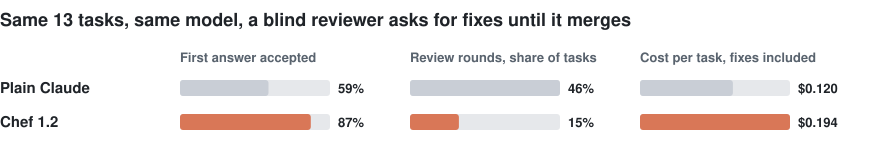

<p align="center">
  
</p>

<h1 align="center">Chef</h1>

<p align="center">
  <em>Your kitchen, your rules. Claude cooks the way you do.</em>
</p>

<p align="center">
  
  
  
  
</p>

**Chef makes Claude write code a reviewer would merge as is.** It costs more per task, and saves you the review round-trips.

<p align="center">
  <picture>
    <source media="(prefers-color-scheme: dark)" srcset="assets/bench/overview-dark.svg">
    
  </picture>
</p>

| | Without chef | With chef |
|---|---|---|
| A blind reviewer would merge it as is | 47% | **89%** |
| Changes the reviewer requires | 0.81 per task | **0.13** per task |
| Cost per task | $0.063 | $0.155 (**2.4×**) |

<sub>13 tasks in 11 stacks, 3 runs each, Sonnet 5.5. The code works either way: every run passes its hidden tests. Reviewers are blind Opus sessions that never know chef exists. <a href="bench/README.md">How it was measured</a>.</sub>

The extra cost is the work a reviewer would ask for anyway: tests, strict types and linters, pinned versions, configs checked by their tools.

## Install

```
/plugin marketplace add Neotoxic-off/chef
```
```
/plugin install chef@chef
```

That's it: chef applies to every coding prompt from now on.

## What chef does

- **Asks before guessing**, and remembers your answers in `.chef.md`.
- **Tests every change**, and sets up a formatter, a linter and a strict type checker. Warnings get fixed, never hidden.
- **Types every signature**, pins dependencies, images and actions.
- **Knows your stack:** 127 references (34 languages, frameworks, infra, CI) with the right tools and configs.
- **Brings a council** of agents for design decisions, and a reviewer for changes.

## Commands

| Command | |
|---|---|
| `/chef:level lite \| full \| max` | How much process: `lite` keeps every code rule but skips the council and reviewer. |
| `/chef:status` | Current level, project settings and detected stacks. |
| `/chef:transform <goal>` | Upgrade or migrate a codebase in small, tested, committed batches. |

## Spend less

- `/chef:level lite` drops the council and the reviewer agent, the biggest cost on large tasks.
- Or skip the plugin: copy [`export/AGENTS.md`](export/AGENTS.md), chef's 12 core rules, into your project. It works with any agent (Codex, Cursor, Copilot) and gets part of the effect: 56% merged as is, at $0.084 per task.

## Change a rule

Edit [`skills/chef/SKILL.md`](skills/chef/SKILL.md) or a stack file in [`skills/chef/references/`](skills/chef/references/), then run `bash scripts/check.sh`. Changes are listed in the [CHANGELOG](CHANGELOG.md).
