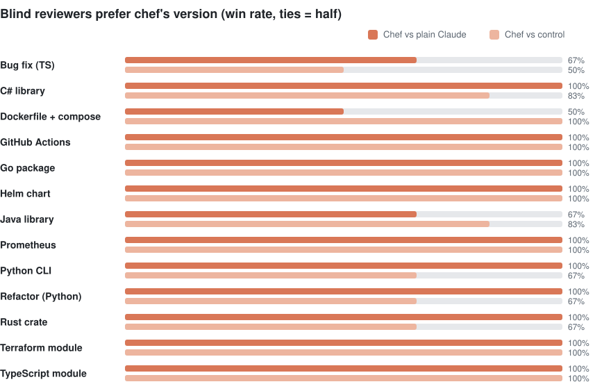
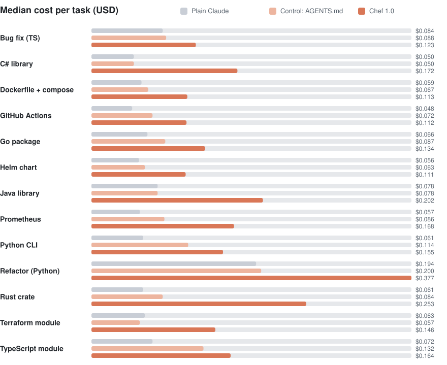
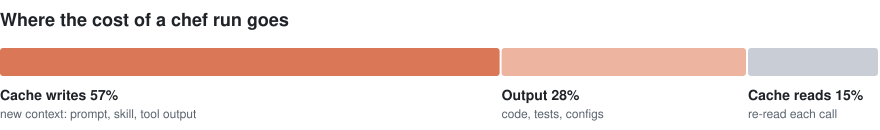

<p align="center">
  
</p>

<h1 align="center">Chef</h1>

<p align="center">
  <em>Your kitchen, your rules. Claude cooks the way you do.</em>
</p>

<p align="center">
  
  
  
  
  
</p>

<p align="center">
  <strong>Blind reviewers would merge chef's code as is 88% of the time, plain Claude's 47%.</strong><br>
  <strong>Preferred on 12 of 13 tasks against plain Claude and against the same rules pasted in an AGENTS.md (p = 0.0005).</strong><br>
  <strong>Tests, typed signatures, strict linters, pinned images and actions, tested alert rules.</strong><br>
  <strong>The price: about 2.4× the cost of a plain run.</strong> Every arm passes every task's correctness check.<br>
  <sub>Benchmarked in Claude Code on 13 tasks across 11 stacks, Sonnet 5.5, 3 runs per arm, judged by blind Opus reviewers who never knew chef existed. <a href="#numbers">Details</a>.</sub>
</p>

---

You know the kitchen. Every pan has its place, every dish is tasted before it leaves, nobody hides a burnt sauce under parsley. Chef puts that kitchen inside Claude Code: one set of house habits, applied on every task, in every project, without being reminded.

## Numbers

Three arms, the same prompt and model (Sonnet 5.5) for each: **plain Claude**, a **control** (plain Claude with chef's 12 core rules in a `CLAUDE.md`, the cheap alternative), and **chef 1.0**. 13 tasks, 3 runs per arm, 117 runs in all.

<p align="center">
  <picture>
    <source media="(prefers-color-scheme: dark)" srcset="assets/bench/pairwise-dark.svg">
    
  </picture>
</p>

| | Plain Claude | Control (`AGENTS.md` rules) | Chef 1.0 |
|---|---|---|---|
| Correct: the task's hidden test or check passes | 100% | 100% | 100% |
| Blind reviewers prefer chef's version (pairs, ties count half) | 91% [81–100] | 86% [76–95] | — |
| Tasks where chef is ahead / behind | 12 / 0 | 12 / 0 | — |
| Would merge as is | 47% | 56% | 88–90% |
| Changes required before merging, per review | 0.81 | 0.73 | 0.12–0.14 |
| Median cost per task | $0.063 | $0.084 | $0.155 |

<sub>Win rate with a 95% bootstrap interval that resamples whole tasks. Ahead / behind counts tasks; a two-sided sign test on 12 / 0 gives p = 0.0005 for both comparisons.</sub>

Every arm writes code that works: correctness is equal. What chef changes is whether a reviewer would accept it. Without chef, about half the submissions need changes before merging; with chef, about one in ten. The same rules pasted in an `AGENTS.md` help a little (56% vs 47% merged as is) but not much, which is where chef's stack references, check commands and workflow earn their cost.

### Cost

<p align="center">
  <picture>
    <source media="(prefers-color-scheme: dark)" srcset="assets/bench/cost-dark.svg">
    
  </picture>
</p>

**The price is real:** 117 runs cost $2.82 for plain Claude, $3.91 for the control and $6.70 for chef, about 2.4× plain and 1.7× the control. Chef writes the tests, configs and pins the others skip, and runs the checkers. On the compiled stacks (Rust, C#, Java) it costs 2.6–4.1× plain, because building and testing take turns.

**Where the money goes.** A per-call trace of one chef run splits its cost like this, with the official cache multipliers for Sonnet 5.5:

<p align="center">
  <picture>
    <source media="(prefers-color-scheme: dark)" srcset="assets/bench/cost-split-dark.svg">
    
  </picture>
</p>

The rules text is a small part of it; the extra work is most of it. Chef 1.0 keeps that work tight: one call per stack check with quiet flags, references read in one batch from an inline index, no file read back after writing it.

### Using chef's rules elsewhere

[`export/AGENTS.md`](export/AGENTS.md) holds chef's 12 core rules for any agent that reads `AGENTS.md` (Codex, Cursor, Copilot, Gemini CLI and others) or `CLAUDE.md`. It is exactly the control arm above: it buys a small part of chef's effect for about a quarter of its extra cost. CI keeps it identical to the core of [`SKILL.md`](skills/chef/SKILL.md).

## Before / after

Same prompt: *"Create a Python command-line tool that reads a TOML config file containing a list of endpoints (url, timeout in seconds), validates it, and prints which entries are invalid and why."* The URL check from each output, unedited.

<table>
<tr><th>Without chef</th><th>With chef</th></tr>
<tr><td valign="top">

One 50-line function doing everything, no types, section comments, no tests, no lint config.

```python
def validate_entry(entry):
    """Return a list of problems for one
    endpoint entry (empty if valid)."""
    if not isinstance(entry, dict):
        return [f"entry must be a table, ..."]

    problems = []

    for key in entry.keys() - {"url", "timeout"}:
        problems.append(f"unknown key '{key}'")

    # url
    if "url" not in entry:
        problems.append("missing 'url'")
    else:
        url = entry["url"]
        if not isinstance(url, str):
            problems.append(f"'url' must be ...")
        elif not url.strip():
            problems.append("'url' is empty")
        else:
            try:
                parts = urlsplit(url)
                host = parts.hostname
                parts.port  # raises ValueError
            except ValueError as exc:
                problems.append(f"malformed ({exc})")
            ...
    # timeout
    ...
```

</td><td valign="top">

One small typed function per check, early returns, named constants. Plus Ruff, `mypy --strict`, and 37 tests at 99% coverage.

```python
ALLOWED_SCHEMES: frozenset[str] = frozenset(
    {"http", "https"})


def validate_url(value: object) -> str | None:
    if not isinstance(value, str):
        return f"url must be a string, ..."
    if not value.strip():
        return "url is empty"
    if any(char.isspace() for char in value):
        return "url must not contain whitespace"
    return validate_url_parts(value)


def validate_url_parts(url: str) -> str | None:
    try:
        parts: SplitResult = urlsplit(url)
        hostname: str | None = parts.hostname
        port: int | None = parts.port
    except ValueError as error:
        return f"url is malformed ({error})"
    if parts.scheme not in ALLOWED_SCHEMES:
        return f"url scheme must be http or https"
    if not hostname:
        return "url has no host"
    if port == 0:
        return "url port must not be 0"
    return None
```

</td></tr>
</table>

## How it works

The house rules, in priority order: **clarity, simplicity, maintainability, security.** Security is never traded away.

- **Not sure? Ask.** Claude asks before guessing what you want, and remembers the answer in `.chef.md`.
- **Talk less.** Result first, about 10 lines, then what was skipped and the risk. No recap, no filler.
- **Typed signatures:** every function signature and public field typed, locals per the language's idiom, no `any`.
- **Tests with every change:** unit and integration, a 90% line and branch coverage gate, mutation testing on critical logic.
- **Never hide a warning.** Fix the cause. No suppression comments, no `|| true`, no lowered thresholds.
- **Pin what you depend on:** lockfiles, image digests, action SHAs.
- **SOLID, few comments.** If code needs many, it is not clear enough.
- **`try`/`catch` only when nothing else works:** check first (`TryParse`, `dict.get`, `Result`), except for files and network.
- **Before heavy commands** (builds, test suites, installs): check free RAM and CPU first.

Each stack has its own reference (linter, formatter, test runner, coverage tool, configs), loaded only when Claude works in it. A stack not listed is still covered: Claude looks up its official tools first, then applies every rule.

**Rules the model skips are enforced by hooks.** `pin-gate.sh` blocks once per session if a GitHub workflow Claude edited uses an action not pinned by commit SHA; workflows you edit yourself are not checked. During `/chef:transform`, a stop gate requires a `Target:` runtime, a `## Council` section, and one commit per ticked batch.

### The council

For decisions, new projects and unclear requests, Claude acts as the lead and convenes a council: three core members always, plus the two or three specialists the problem calls for. They answer in parallel without seeing each other, then cross-examine; the lead brings you the real choices.

| Agent | Seat | Role |
|---|---|---|
| `council-senior` | core | Knows the stack and the project; proposes the plan and what to reuse. |
| `council-skeptic` | core | Argues it will not work, with evidence, until the plan holds. |
| `council-novice` | core | Knows nothing; asks the simple questions experts skip. |
| `council-researcher` | specialist | Official docs, versions, known issues; cites every source. |
| `council-outsider` | specialist | Never reads the code; reasons from first principles. |
| `council-security` | specialist | Threat model, inputs, secrets, auth, supply chain. |
| `council-ops` | specialist | Deploy, observability, failure modes, rollback, cost. |
| `council-user` | specialist | The real need of whoever uses the result: UX, accessibility. |
| `council-maintainer` | specialist | Owns the code in two years: readability, tests, cost of change. |

One more agent, `reviewer`, did not write the code: it checks every change against the house rules before you see it.

## Install

In Claude Code, as two separate prompts:

```
/plugin marketplace add Neotoxic-off/chef
```
```
/plugin install chef@chef
```

Update: `/plugin marketplace update chef`, then `/reload-plugins`.

That's it. A `UserPromptSubmit` hook routes every development prompt through chef from now on.

## Commands

| Command | What it does |
|---|---|
| `/chef:chef` | Load the house rules now. Usually not needed: the hook does it on every development prompt. |
| `/chef:level [lite \| full \| max]` | Set how much ceremony chef uses in this project, saved in `.chef.md`. No argument shows the current level. |
| `/chef:status` | The active level, the `.chef.md` overrides, the detected stacks, and this session's tokens, subagents and time. |
| `/chef:transform <goal>` | Upgrade or migrate the repo in small batches: baseline, plan in `TRANSFORM.md`, council, your approval, then each batch validated, reviewed and committed. Resumes where it stopped. |

| Level | What changes |
|---|---|
| `lite` | Every code rule (types, tests, lint, security). No council, no reviewer agent. Cheapest. |
| `full` | Default. Council for decisions, reviewer on changes. |
| `max` | Council on every non-trivial change, reviewer always. |

## Stacks covered

| Area | Covered |
|---|---|
| Languages | C#/.NET, TypeScript/JS, Python, Rust, Go, C, C++, Java, Kotlin, Swift, Dart, PHP, Ruby, Scala, Elixir, Lua, Bash, PowerShell, SQL, Zig, Haskell, OCaml, F#, Clojure, Erlang, R, Julia, Perl, Objective-C, Solidity, WebAssembly, CUDA, embedded C/C++, VHDL/Verilog |
| Frontend | React, Next.js, Vue/Nuxt, Angular, Svelte/SvelteKit, Astro, React Router/Remix, SolidJS, Qwik, htmx, Blazor, Tailwind, Vite/webpack/Rolldown, Playwright/Cypress, Storybook |
| Backend | ASP.NET Core, NestJS/Express/Fastify, Django, FastAPI/Flask, Spring Boot, Laravel, Rails, Symfony, Phoenix, Axum/Actix, Go web, Ktor, Quarkus/Micronaut, Deno/Bun/Hono |
| Mobile, desktop, games | Flutter, React Native/Expo, Jetpack Compose, SwiftUI, WPF/WinUI, .NET MAUI, Avalonia, Electron, Tauri, Qt, Unity, Godot, Unreal |
| Cloud and infrastructure | Docker, Kubernetes/Helm, Terraform/OpenTofu, Pulumi, Bicep, AWS CDK, AWS, Azure, GCP, serverless, GitOps, secrets, Ansible, Nginx/Caddy/Traefik, Linux/systemd, Nix, service mesh, CI/CD, Git, Make/just, monorepos, config files |
| Observability | OpenTelemetry, Prometheus, Grafana, Loki, Tempo/Jaeger, logging, SLOs |
| Data and AI | PostgreSQL, Redis/Valkey, MongoDB, Kafka/RabbitMQ, Elasticsearch/OpenSearch, ORMs, pandas/Polars, notebooks, PyTorch/scikit-learn, LLM apps, Airflow/Dagster/dbt/Spark, Flink |
| Cross-cutting | REST/OpenAPI, GraphQL, gRPC, security (OWASP), accessibility (WCAG), i18n, WebSockets |
| Transformations | .NET Framework and .NET upgrades, Java and Spring Boot upgrades (OpenRewrite), Python version upgrades, TypeScript strict mode and Node/framework majors, raising test coverage to 90% |

## FAQ

**Does it need a config file?**
No. `.chef.md` at the project root is created only when you set a level or answer a question chef would otherwise ask again. Commit it to share the choices with your team.

**It costs more. Can I turn it down?**
`/chef:level lite` keeps every code rule but drops the council and the reviewer agent, the biggest extra cost on large tasks. On small tasks, most of the extra cost is the tests and checks themselves (see [Cost](#cost)). For the lightest option, copy [`export/AGENTS.md`](export/AGENTS.md) into your project instead of installing the plugin.

**Will it rewrite my legacy code?**
No. Its style rules apply to the lines it adds or must change. Strict mode is asked first in an existing project, and `/chef:transform` keeps the diff to what the migration needs.

**How do I change a habit?**
Edit [`skills/chef/SKILL.md`](skills/chef/SKILL.md), or the stack's file in [`skills/chef/references/`](skills/chef/references/) (listed in [`INDEX.md`](skills/chef/references/INDEX.md)). Run `bash scripts/check.sh` before you push; CI runs it too.

**Why "chef"?**
Because the kitchen has rules, and the dish is tasted before it leaves.

## Benchmark details

Run on Nov 19, 2026 with Claude Code 2.1.328 and Sonnet 5.5. For each task and run, the three arms run side by side in fresh git folders. User settings, other plugins and MCP servers are off in every arm (`--setting-sources project --strict-mcp-config`); the control gets its rules as the workspace `CLAUDE.md`, chef gets `--plugin-dir`. Every prompt states the task only, never tests, types or style, and ends with "Work autonomously: nobody will answer questions." Each run is capped at $1. The machine had every toolchain installed (Node, Go, Rust, .NET, JDK + Maven, Terraform, Helm, actionlint, Docker), the same for every arm.

| Task | The prompt asks for | Correctness check |
|---|---|---|
| Python CLI | A TOML endpoint validator | Hidden pytest |
| TypeScript module | A duration parser | Hidden `node:test` |
| Go package | A port-range parser | Hidden `_test.go` |
| Rust crate | A semantic version comparator | Hidden integration test |
| C# library | An invoice calculator | Hidden xUnit project |
| Java library | A duration parser (Maven) | Hidden JUnit 5 test |
| Dockerfile + compose | Containerize a small HTTP service | `docker build`, then `GET /health` |
| Prometheus | Scrape config and three alerts | `promtool check config` and `check rules` |
| Terraform module | An S3 log bucket | `terraform validate` and plan checks |
| Helm chart | Deploy the HTTP service | `helm lint`, `kubeconform -strict`, rendered requirements |
| GitHub Actions | CI for a small Python project | `actionlint`, triggers and test step |
| Bug fix (TypeScript) | A user's bug report on a cart module | Hidden test of the scenario plus regressions |
| Refactor (Python) | Clean up a messy invoice module | 89-case characterization test |

**Judging.** For every task and run, chef's workspace and the other arm's go side by side, as `first/` and `second/`, to a blind Opus 5.5 reviewer asked which one it would merge, from the seats of a senior engineer, a security reviewer, an SRE and a maintainer. History, caches and files that name a tool (`CLAUDE.md`, `AGENTS.md`, `.chef.md`) are removed. Each pair is judged twice, in both orders, by separate `claude -p --restricted` sessions with read-only tools confined to that folder; a win counts only when both orders agree, otherwise it is a tie. 156 judgments in all.

Reproduce:

```bash
bash bench/run.sh <new-out-dir> 3 none= control=export/AGENTS.md chef=<chef-dir>
python bench/score.py <out-dir> > scores.json
python bench/pairwise_review.py judge <out-dir> <review-dir> none chef
python bench/pairwise_review.py summarize <review-dir> > chef-vs-none.json
python bench/report.py scores.json <out-dir>/versions.txt chef-vs-none.json chef-vs-control.json
python bench/charts.py
```

`TASKS="python go"` runs a subset. The scorers need pytest, pytest-cov, mypy, Ruff, PyYAML, zizmor and Docker; numbers and charts come from [`bench/results/summary.json`](bench/results/summary.json).

<details>
<summary><strong>Weak spots and limits</strong></summary>

- 3 runs per arm per task. The task-level result (12 of 13 ahead, none behind) is significant; per-task win rates are not.
- The judge is a Claude model (Opus 5.5 judging Sonnet 5.5 code), so a shared taste cannot be ruled out. Pairwise judging in both orders removes position bias, not model bias.
- Blind folders hide names, not style: a reviewer can see that one side wrote tests and configs. That is what the reviewer is asked to weigh, but it means "blind" covers identity, not approach.
- The tasks are small, single-session and mostly new code; two (the bug fix and the refactor) change existing code. No run used chef's council or reviewer agents, so they are not measured here.
- One chef run of the refactor task wrote scratch files next to its workspace, outside it. Nothing was harmed, but the harness now ignores such folders.
- The cost split comes from one traced run.
- Earlier benchmarks (0.8 to 0.10) are in the git history of this README.

</details>
