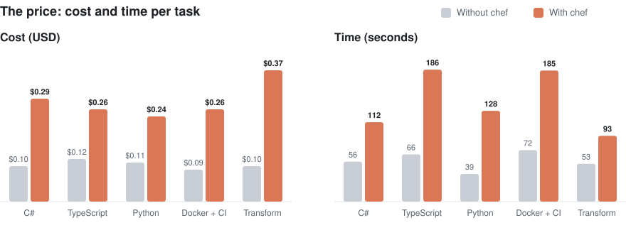

<p align="center">
  
</p>

<h1 align="center">Chef</h1>

<p align="center">
  <em>Your kitchen, your rules. Claude cooks the way you do.</em>
</p>

<p align="center">
  
  
  
  
  
</p>

<p align="center">
  <strong>Tested code in 88% of runs, without chef 0%.</strong><br>
  <strong>86% line coverage &middot; explicit types &middot; strict linters &middot; warnings as errors</strong><br>
  <strong>And the code works either way:</strong> hidden tests pass in 100% of runs, with or without chef.<br>
  <sub>Benchmarked in Claude Code, the same agent with and without the plugin: 5 tasks, Sonnet 5.5, 2 runs each, every result checked by real tools. <a href="#numbers">Details</a>.</sub>
</p>

---

You know the kitchen. Every pan has its place, every dish is tasted before it leaves, nobody hides a burnt sauce under parsley. Chef puts that kitchen inside Claude Code: one set of house habits, applied on every task, in every project, without being reminded.

## Numbers

<p align="center">
  <picture>
    <source media="(prefers-color-scheme: dark)" srcset="assets/bench/scorecard-dark.svg">
    
  </picture>
</p>

Without chef, Claude writes code that works, and nothing around it: no tests in any run, no strict tooling, inferred types. With chef, the same code ships with tests, coverage, explicit types and a linter that fails on warnings.

<p align="center">
  <picture>
    <source media="(prefers-color-scheme: dark)" srcset="assets/bench/cost-time-dark.svg">
    
  </picture>
</p>

**The price is real:** about 2.5× the cost and 1.7–3.3× the time per task. `/chef:level lite` drops the council and the reviewer when you want the rules without the ceremony.

Every result is checked by running tools on the output, with the same settings for both arms: a hidden test that calls the function the prompt asked for, `mypy --strict`, `tsc --strict`, compiler warnings, ruff, hadolint, and measured line coverage. Per-task tables and limits are in [Benchmark details](#benchmark-details).

## Before / after

Same prompt: *"Create a Python command-line tool that reads a TOML config file containing a list of endpoints (url, timeout in seconds), validates it, and prints which entries are invalid and why."* The URL check from each output, unedited.

<table>
<tr><th>Without chef</th><th>With chef</th></tr>
<tr><td valign="top">

One 50-line function doing everything, no types, section comments, no tests, no lint config.

```python
def validate_entry(entry):
    """Return a list of problems for one
    endpoint entry (empty if valid)."""
    if not isinstance(entry, dict):
        return [f"entry must be a table, ..."]

    problems = []

    for key in entry.keys() - {"url", "timeout"}:
        problems.append(f"unknown key '{key}'")

    # url
    if "url" not in entry:
        problems.append("missing 'url'")
    else:
        url = entry["url"]
        if not isinstance(url, str):
            problems.append(f"'url' must be ...")
        elif not url.strip():
            problems.append("'url' is empty")
        else:
            try:
                parts = urlsplit(url)
                host = parts.hostname
                parts.port  # raises ValueError
            except ValueError as exc:
                problems.append(f"malformed ({exc})")
            ...
    # timeout
    ...
```

</td><td valign="top">

One small typed function per check, early returns, named constants. Plus Ruff, `mypy --strict`, and 37 tests at 99% coverage.

```python
ALLOWED_SCHEMES: frozenset[str] = frozenset(
    {"http", "https"})


def validate_url(value: object) -> str | None:
    if not isinstance(value, str):
        return f"url must be a string, ..."
    if not value.strip():
        return "url is empty"
    if any(char.isspace() for char in value):
        return "url must not contain whitespace"
    return validate_url_parts(value)


def validate_url_parts(url: str) -> str | None:
    try:
        parts: SplitResult = urlsplit(url)
        hostname: str | None = parts.hostname
        port: int | None = parts.port
    except ValueError as error:
        return f"url is malformed ({error})"
    if parts.scheme not in ALLOWED_SCHEMES:
        return f"url scheme must be http or https"
    if not hostname:
        return "url has no host"
    if port == 0:
        return "url port must not be 0"
    return None
```

</td></tr>
</table>

## How it works

The house rules, in priority order: **clarity, simplicity, maintainability, security.** Security is never traded away.

- **Not sure? Ask.** Claude asks before guessing what you want, and remembers the answer in `.chef.md`.
- **Talk less.** Result first, about 10 lines, then what was skipped and the risk. No recap, no filler.
- **Explicit types** on every variable, parameter, return and field, in every typed language.
- **Tests with every change:** unit and integration, a 90% line and branch coverage gate, mutation testing on critical logic.
- **Never hide a warning.** Fix the cause. No suppression comments, no `|| true`, no lowered thresholds.
- **SOLID, few comments.** If code needs many, it is not clear enough.
- **`try`/`catch` only when nothing else works:** check first (`TryParse`, `dict.get`, `Result`), except for files and network.
- **Before heavy commands** (builds, test suites, installs): check free RAM and CPU first.

Each stack has its own reference (linter, formatter, test runner, coverage tool, configs), loaded only when Claude works in it. A stack not listed is still covered: Claude looks up its official tools first, then applies every rule.

**Rules the model skips are enforced by hooks.** `pin-gate.sh` blocks once per session if a GitHub workflow Claude edited uses an action not pinned by commit SHA; workflows you edit yourself are not checked. During `/chef:transform`, a stop gate requires a `Target:` runtime, a `## Council` section, and one commit per ticked batch.

### The council

For decisions, new projects and unclear requests, Claude acts as the lead and convenes a council: three core members always, plus the two or three specialists the problem calls for. They answer in parallel without seeing each other, then cross-examine; the lead brings you the real choices.

| Agent | Seat | Role |
|---|---|---|
| `council-senior` | core | Knows the stack and the project; proposes the plan and what to reuse. |
| `council-skeptic` | core | Argues it will not work, with evidence, until the plan holds. |
| `council-novice` | core | Knows nothing; asks the simple questions experts skip. |
| `council-researcher` | specialist | Official docs, versions, known issues; cites every source. |
| `council-outsider` | specialist | Never reads the code; reasons from first principles. |
| `council-security` | specialist | Threat model, inputs, secrets, auth, supply chain. |
| `council-ops` | specialist | Deploy, observability, failure modes, rollback, cost. |
| `council-user` | specialist | The real need of whoever uses the result: UX, accessibility. |
| `council-maintainer` | specialist | Owns the code in two years: readability, tests, cost of change. |

One more agent, `reviewer`, did not write the code: it checks every change against the house rules before you see it.

## Install

In Claude Code, as two separate prompts:

```
/plugin marketplace add Neotoxic-off/chef
```
```
/plugin install chef@chef
```

Update: `/plugin marketplace update chef`, then `/reload-plugins`.

That's it. A `UserPromptSubmit` hook routes every development prompt through chef from now on.

## Commands

| Command | What it does |
|---|---|
| `/chef:chef` | Load the house rules now. Usually not needed: the hook does it on every development prompt. |
| `/chef:level [lite \| full \| max]` | Set how much ceremony chef uses in this project, saved in `.chef.md`. No argument shows the current level. |
| `/chef:status` | The active level, the `.chef.md` overrides, the detected stacks, and this session's tokens, subagents and time. |
| `/chef:transform <goal>` | Upgrade or migrate the repo in small batches: baseline, plan in `TRANSFORM.md`, council, your approval, then each batch validated, reviewed and committed. Resumes where it stopped. |

| Level | What changes |
|---|---|
| `lite` | Every code rule (types, tests, lint, security). No council, no reviewer agent. Cheapest. |
| `full` | Default. Council for decisions, reviewer on changes. |
| `max` | Council on every non-trivial change, reviewer always. |

## Stacks covered

| Area | Covered |
|---|---|
| Languages | C#/.NET, TypeScript/JS, Python, Rust, Go, C, C++, Java, Kotlin, Swift, Dart, PHP, Ruby, Scala, Elixir, Lua, Bash, PowerShell, SQL, Zig, Haskell, OCaml, F#, Clojure, Erlang, R, Julia, Perl, Objective-C, Solidity, WebAssembly, CUDA, embedded C/C++, VHDL/Verilog |
| Frontend | React, Next.js, Vue/Nuxt, Angular, Svelte/SvelteKit, Astro, React Router/Remix, SolidJS, Qwik, htmx, Blazor, Tailwind, Vite/webpack/Rolldown, Playwright/Cypress, Storybook |
| Backend | ASP.NET Core, NestJS/Express/Fastify, Django, FastAPI/Flask, Spring Boot, Laravel, Rails, Symfony, Phoenix, Axum/Actix, Go web, Ktor, Quarkus/Micronaut, Deno/Bun/Hono |
| Mobile, desktop, games | Flutter, React Native/Expo, Jetpack Compose, SwiftUI, WPF/WinUI, .NET MAUI, Avalonia, Electron, Tauri, Qt, Unity, Godot, Unreal |
| Cloud and infrastructure | Docker, Kubernetes/Helm, Terraform/OpenTofu, Pulumi, Bicep, AWS CDK, AWS, Azure, GCP, serverless, GitOps, secrets, Ansible, Nginx/Caddy/Traefik, Linux/systemd, Nix, service mesh, CI/CD, Git, Make/just, monorepos, config files |
| Observability | OpenTelemetry, Prometheus, Grafana, Loki, Tempo/Jaeger, logging, SLOs |
| Data and AI | PostgreSQL, Redis/Valkey, MongoDB, Kafka/RabbitMQ, Elasticsearch/OpenSearch, ORMs, pandas/Polars, notebooks, PyTorch/scikit-learn, LLM apps, Airflow/Dagster/dbt/Spark, Flink |
| Cross-cutting | REST/OpenAPI, GraphQL, gRPC, security (OWASP), accessibility (WCAG), i18n, WebSockets |
| Transformations | .NET Framework and .NET upgrades, Java and Spring Boot upgrades (OpenRewrite), Python version upgrades, TypeScript strict mode and Node/framework majors, raising test coverage to 90% |

## FAQ

**Does it need a config file?**
No. `.chef.md` at the project root is created only when you set a level or answer a question chef would otherwise ask again. Commit it to share the choices with your team.

**It costs more. Can I turn it down?**
`/chef:level lite` keeps every code rule but drops the council and the reviewer agent, which is where most of the extra cost goes.

**Will it rewrite my legacy code?**
No. Its style rules apply to the lines it adds or must change. Strict mode is asked first in an existing project, and `/chef:transform` keeps the diff to what the migration needs.

**How do I change a habit?**
Edit [`skills/chef/SKILL.md`](skills/chef/SKILL.md), or the stack's file in [`skills/chef/references/`](skills/chef/references/) (listed in [`INDEX.md`](skills/chef/references/INDEX.md)). Run `bash scripts/check.sh` before you push; CI runs it too.

**Why "chef"?**
Because the kitchen has rules, and the dish is tasted before it leaves.

## Benchmark details

Same prompt, same model (Sonnet 5.5), fresh git folder each time. The only difference is the chef plugin; every other plugin is off in both arms. 5 tasks × 2 runs per arm, run on Nov 19, 2026. Each prompt names the function to write, so a hidden test Claude never saw can call it after the run.

<details>
<summary><strong>New code: C#, TypeScript, Python, Docker + CI</strong></summary>

| Task | Metric | Without chef | With chef |
|---|---|---|---|
| C# library | Hidden tests pass | 2/2 | 2/2 |
| | Test cases written | 0 | 8.5 |
| | Tests pass | no tests | 1/2 |
| | Line coverage | 0% | 100% / 0% |
| | `var` (inferred types) | 2 | 0 |
| | Build warnings | 0 | 0 |
| | `TreatWarningsAsErrors` | 0/2 | 2/2 |
| TypeScript module | Hidden tests pass | 2/2 | 2/2 |
| | Test cases written | 0 | 4.5 |
| | Line coverage | 0% | 100% |
| | Untyped `const`/`let` | 4.5 | 0.5 |
| | `tsc --strict` errors | 0 | 0 |
| | ESLint config | 0/2 | 2/2 |
| Python CLI | Hidden tests pass | 2/2 | 2/2 |
| | Test cases written | 0 | 11 |
| | Line coverage | 0% | 97.8% |
| | `mypy --strict` errors | 2 | 0 |
| | Ruff findings (default rules) | 3 | 2 |
| | Ruff + strict type checker config | 0/2 | 2/2 |
| Dockerfile + CI | `HEALTHCHECK`, base image pinned by digest | 0/2 | 2/2 |
| | `permissions:` block | 1/2 | 2/2 |
| | Actions pinned by SHA | 0/2 | 0/2 |
| | Hadolint findings | 1 | 1 |
| All four | Cost per task | $0.09–0.12 | $0.24–0.29 |
| | Time per task | 39–73 s | 112–186 s |

</details>

<details>
<summary><strong>Transformation: Python 3.8 to 3.13</strong></summary>

The seed is a small legacy module with no tests. It uses `distutils.util.strtobool`, `datetime.utcnow()`, `typing.List` and `python_requires=">=3.8"`. Prompt: upgrade it to Python 3.13, keep the public functions and their behavior. With chef, the same prompt starts with `/chef:transform`. The hidden test runs on Python 3.13 with `DeprecationWarning` as an error; the untouched seed fails it.

| Metric | Without chef | With chef |
|---|---|---|
| Hidden tests pass on 3.13 | 2/2 | 2/2 |
| `distutils` and `utcnow()` removed, `python_requires>=3.13` | 2/2 | 2/2 |
| Characterization tests written | 0 | 11, all pass |
| Line coverage | 0% | 95.2% |
| `TRANSFORM.md` with baseline, batches and report | 0/2 | 2/2 |
| Commits | 0 | 4 |
| `reviewer` agent on the diff | 0/2 | 1/2 |
| Council on the plan | 0/2 | 0/2 |
| Cost per task | $0.10 | $0.37 |

</details>

<details>
<summary><strong>Weak spots and limits</strong></summary>

Weak spots seen in this run (before v0.8):

- **C# run without tests:** in one run, the `dotnet add package` calls never reached the test project, so its tests do not build.
- **Actions not pinned by SHA,** even though the rule is in `ci.md`. Now enforced by `pin-gate.sh`.
- **Transform steps skipped:** no council, and the reviewer ran in one run of two. The `## Council` section and one commit per batch are now enforced by the transform stop gate.

Limits:

- 2 runs per arm is a small sample.
- Times are inflated by the checks running in parallel on the same machine. Compare the arms, not the absolute seconds.
- `docker build` and actionlint were not run.
- The harness is not in the repo.

</details>
