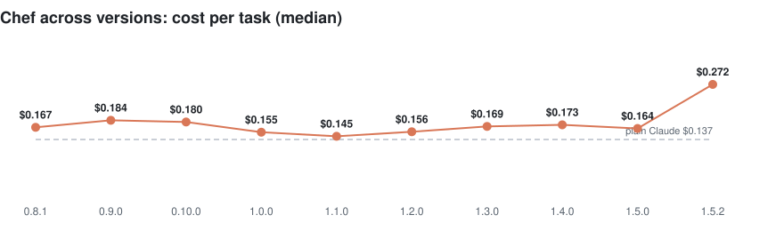

<p align="center">
  
</p>

<h1 align="center">Chef</h1>

<p align="center">
  <em>Your AI-powered coding chef crafting clean, secure, and maintainable code with precision</em>
</p>

<p align="center">
  
  
  
  
  
</p>

## Install

```
/plugin marketplace add Neotoxic-off/chef
```
```
/plugin install chef@chef
```

Chef then applies to every coding prompt.

## What chef does

- **Tests every change** and sets up a formatter, a linter and a strict type checker. Warnings get fixed, never hidden.
- **Types and pins:** every signature typed; dependencies, images and actions pinned.
- **Knows your stack:** 127 references (34 languages, frameworks, infra, CI).
- **Asks before guessing**, and remembers your answers in `.chef.md`. Your explicit instruction wins, never over security.
- **Brings a council** of agents for design decisions, and a reviewer for changes spanning several modules.
- **Talks less:** short replies, the smallest complete change ([`lean.md`](skills/chef/lean.md), adapted from [ponytail](https://github.com/DietrichGebert/ponytail), MIT).

## Results

A blind reviewer that never knows chef exists asks for fixes until it would merge. Same tasks, same model (Sonnet 5.5). [How it was measured](bench/README.md).

### Chef 1.6 against 1.5, 1.4 and plain Claude

Chef 1.6 had every first answer accepted on the 13, 11 and 7-task benches, like 1.4 and unlike 1.5 (one miss on the 11 tasks). It costs 4% less than 1.5 on the 11 tasks and 6% less on the DevOps and CI tasks, and 2% more on the 13 older tasks; against 1.4 it costs 26% to 36% less. Against plain Claude it costs 1.7 to 2 times as much per task, and takes about 1.6 times as long to a merged change.

<p align="center">
  <picture>
    <source media="(prefers-color-scheme: dark)" srcset="assets/bench/time-dark.svg">
    
  </picture>
</p>

Chef 1.6 is the cheaper option once a human review round costs more than $0.86.

<p align="center">
  <picture>
    <source media="(prefers-color-scheme: dark)" srcset="assets/bench/break-even-dark.svg">
    
  </picture>
</p>

Chef against caveman and ponytail, 4 tasks, 2 runs each: trends, not proof.

<p align="center">
  <picture>
    <source media="(prefers-color-scheme: dark)" srcset="assets/bench/styles-dark.svg">
    
  </picture>
</p>

Caveman and ponytail shorten replies and code, so they cost less than plain Claude; chef's extra cost buys the tests, linter and type checker it sets up and runs. Chef 1.6 costs 17% less than 1.5 here.

### Code quality per language

One task for each of the 32 most-used references, the mean of a blind reviewer's scores for quality, clarity, maintainability and functionality. Chef 1.6 scores 8.5 against 8.0 for plain Claude, higher on 24 of the 32 languages and lower on 3.

<p align="center">
  <picture>
    <source media="(prefers-color-scheme: dark)" srcset="assets/bench/quality-dark.svg">
    
  </picture>
</p>

### Across versions

Cost per task as a multiple of plain Claude's, on the three tasks every version ran (Python CLI, Dockerfile + compose, Prometheus).

<p align="center">
  <picture>
    <source media="(prefers-color-scheme: dark)" srcset="assets/bench/history-cost-dark.svg">
    
  </picture>
</p>

## Commands

| Command | |
|---|---|
| `/chef:level lite \| full \| max` | How much process: `lite` keeps every code rule, skips the council and reviewer. |
| `/chef:status` | Current level, project settings and detected stacks. |
| `/chef:transform <goal>` | Upgrade or migrate a codebase in small, tested batches. |

## Spend less

- `/chef:level lite` drops the council and the reviewer.
- Turn chef off in one project: `claude plugin disable chef@chef --scope local`.
- No plugin: copy [`export/AGENTS.md`](export/AGENTS.md), chef's core rules, into any agent's project.

## Change a rule

Edit [`skills/chef/SKILL.md`](skills/chef/SKILL.md) or a file in [`skills/chef/references/`](skills/chef/references/), then run `bash scripts/check.sh`. See the [CHANGELOG](CHANGELOG.md).
