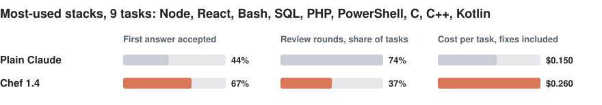

<p align="center">
  
</p>

<h1 align="center">Chef</h1>

<p align="center">
  <em>Your AI-powered coding chef crafting clean, secure, and maintainable code with precision</em>
</p>

<p align="center">
  
  
  
  
</p>

<p align="center">
  <picture>
    <source media="(prefers-color-scheme: dark)" srcset="assets/bench/overview-dark.svg">
    
  </picture>
</p>

| | Without chef | Chef 1.2 | Chef 1.3 | Chef 1.4 |
|---|---|---|---|---|
| The reviewer accepts the first answer | 59% | 87% | 90% | **92%** |
| Tasks sent back for fixes | 41% | 13% | 10% | **8%** |
| Review rounds, as a share of tasks | 46% | 15% | 13% | **10%** (−78%) |
| Lines the reviewer reads, median (lockfiles excluded) | 98 | 231 | 233 | 226 (+131%) |
| Agent time per task, first answer | 21 s | 42 s | 44 s | 46 s (+117%) |
| Agent time per task, fixes and new reviews | 29 s | 11 s | 7 s | **7 s** (−76%) |
| Cost per task, review fixes included | $0.120 | $0.194 | $0.181 | $0.185 (**+54%**) |

<sub>13 tasks in 11 stacks, 3 runs each, Sonnet 5.5; percentages compare chef 1.4 with plain Claude. Chef 1.2, 1.3 and 1.4 differ by one or two reviews out of 39: read them as equal. The reviewer is a blind Opus session that never knows chef exists; when it would not merge, its required changes go back to the same setup, up to 2 rounds. The code works either way: every first answer passes its hidden tests. Runs cut short by an API or usage limit are refused, not counted; each result names the harness commit and reviewer that produced it, and every scorer is tested in CI on a known-good and a known-bad answer. <a href="bench/README.md">How it was measured</a>.</sub>

Chef 1.4's first answer costs 134% more than a plain one, because it already does what the reviewer would ask for: tests, strict types and linters, pinned versions, configs checked by their tools. Counting the fixes plain Claude needs afterwards, the gap falls to +54%, for 78% fewer review rounds. In agent time the two end level (73 s and 78 s per task until merged, +7%); the difference is on the reviewer's side: 81% fewer tasks come back for another review.

Across versions, on the Python, Docker and Prometheus tasks every version was run on:

<p align="center">
  <picture>
    <source media="(prefers-color-scheme: dark)" srcset="assets/bench/history-merge-dark.svg">
    
  </picture>
</p>

<p align="center">
  <picture>
    <source media="(prefers-color-scheme: dark)" srcset="assets/bench/history-cost-dark.svg">
    
  </picture>
</p>

<p align="center">
  <picture>
    <source media="(prefers-color-scheme: dark)" srcset="assets/bench/time-dark.svg">
    
  </picture>
</p>

Per token, chef is less cost-effective: $1 buys 8.2 accepted first answers without it and 5.4 with chef 1.4. What it saves is the reviewer's rounds: 1.10 reviews per task instead of 1.46. Once a review round costs more than **$0.18** of the reviewer's time (about 11 seconds at $60/h), chef is the cheaper option; at $10 per round, $11.19 per task against $14.72 (−24%).

<p align="center">
  <picture>
    <source media="(prefers-color-scheme: dark)" srcset="assets/bench/break-even-dark.svg">
    
  </picture>
</p>

<sub>Reviews per task are the first review plus one after each fix. The model prices a round, not the lines in it: chef 1.4's code takes 2.3 times as many lines to read (median 226 against 98, lockfiles excluded).</sub>

### Most-used stacks

Nine more tasks in the languages and tools developers use most, run on chef 1.4, 3 runs each, with the current reviewer:

<p align="center">
  <picture>
    <source media="(prefers-color-scheme: dark)" srcset="assets/bench/stacks-dark.svg">
    
  </picture>
</p>

| First answer accepted, of 3 | Node | React | Bash | SQL | PHP | PowerShell | C | C++ | Kotlin |
|---|---|---|---|---|---|---|---|---|---|
| Without chef | 0 | 3 | 3 | 2 | 1 | 0 | 0 | 0 | 3 |
| Chef 1.4 | **3** | 1 | 3 | 2 | **3** | 0 | **3** | **1** | 2 |

<sub>Chef is ahead on 4 stacks, behind on 2 and level on 3; with 3 runs per stack, read the total, not a single stack. Every chef first answer passes its hidden test; plain Claude fails 2 of 27 (PHP, a `composer.json` that is not valid JSON). <a href="bench/README.md">How it was measured</a>.</sub>

## Install

```
/plugin marketplace add Neotoxic-off/chef
```
```
/plugin install chef@chef
```

That's it: chef applies to every coding prompt from now on.

## What chef does

- **Asks before guessing:** one question when that settles it, the council when it does not. Remembers your answers in `.chef.md`.
- **Your word wins:** an explicit instruction in your prompt overrides chef's conventions and `.chef.md`, never security or the project folder.
- **Tests every change**, and sets up a formatter, a linter and a strict type checker. Warnings get fixed, never hidden.
- **Types every signature**, pins dependencies, images and actions.
- **Knows your stack:** 127 references (34 languages, frameworks, infra, CI) with the right tools and configs. The 11 stacks the benchmark covers (Python, TypeScript, Go, Rust, Java, C#, Docker, Helm, Terraform, GitHub Actions, Prometheus) are checked by it; the others say which versions they were written for, and that they are not benchmarked.
- **Brings a council** of agents for design decisions, and a reviewer for changes. The benchmark measures neither: its tasks are small and run without them.
- **Talks less:** short replies, agent reports capped at 20 lines, and the smallest complete change ([`lean.md`](skills/chef/lean.md), adapted from [ponytail](https://github.com/DietrichGebert/ponytail), MIT).

## Commands

| Command | |
|---|---|
| `/chef:level lite \| full \| max` | How much process: `lite` keeps every code rule but skips the council and reviewer. |
| `/chef:status` | Current level, project settings and detected stacks. |
| `/chef:transform <goal>` | Upgrade or migrate a codebase in small, tested, committed batches. |

## Spend less

- `/chef:level lite` drops the council and the reviewer agent, the biggest cost on large tasks.
- Turn chef off in one project, for you only: `claude plugin disable chef@chef --scope local`.
- Or skip the plugin: copy [`export/AGENTS.md`](export/AGENTS.md), chef's 12 core rules, into your project. It works with any agent (Codex, Cursor, Copilot) and gets part of the effect (in the 1.0 benchmark: 56% merged as is against 89% with chef, at $0.084 per task).

## Change a rule

Edit [`skills/chef/SKILL.md`](skills/chef/SKILL.md) or a stack file in [`skills/chef/references/`](skills/chef/references/), then run `bash scripts/check.sh`. Changes are listed in the [CHANGELOG](CHANGELOG.md).
