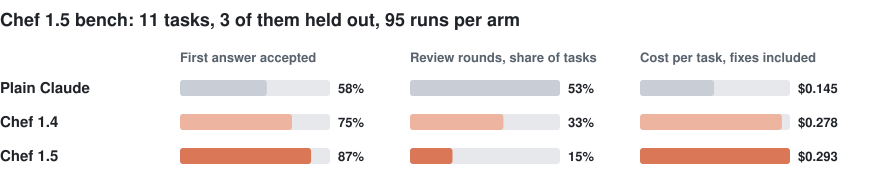
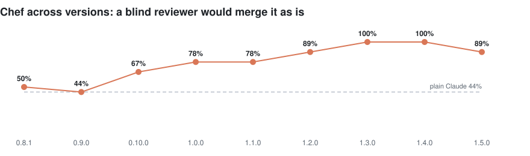

<p align="center">
  
</p>

<h1 align="center">Chef</h1>

<p align="center">
  <em>Your AI-powered coding chef crafting clean, secure, and maintainable code with precision</em>
</p>

<p align="center">
  
  
  
  
  
</p>

## Install

```
/plugin marketplace add Neotoxic-off/chef
```
```
/plugin install chef@chef
```

Chef then applies to every coding prompt.

## What chef does

- **Tests every change** and sets up a formatter, a linter and a strict type checker. Warnings get fixed, never hidden.
- **Types and pins:** every signature typed; dependencies, images and actions pinned.
- **Knows your stack:** 127 references (34 languages, frameworks, infra, CI).
- **Asks before guessing**, and remembers your answers in `.chef.md`. Your explicit instruction wins, never over security.
- **Brings a council** of agents for design decisions, and a reviewer for changes.
- **Talks less:** short replies, the smallest complete change ([`lean.md`](skills/chef/lean.md), adapted from [ponytail](https://github.com/DietrichGebert/ponytail), MIT).

## Results

A blind reviewer that never knows chef exists asks for fixes until it would merge. Same tasks, same model (Sonnet 5.5). [How it was measured](bench/README.md).

<p align="center">
  <picture>
    <source media="(prefers-color-scheme: dark)" srcset="assets/bench/overview-15-dark.svg">
    
  </picture>
</p>

| | Without chef | Chef 1.4 | Chef 1.5 |
|---|---|---|---|
| First answer accepted | 58% | 75% | **87%** |
| Review rounds per task | 0.53 | 0.33 | **0.15** |
| Cost per task, fixes included | $0.145 | $0.278 | $0.294 |
| Median time, first answer | 21 s | 65 s | 94 s |

Chef 1.5 against 1.4: +13 points (p = 0.04), with half the review rounds. Its first answer is slower: it now runs every check, from a container when a tool is missing.

Code quality on the 32 most-used references, one task each, scored 0 to 10 by a blind reviewer:

<p align="center">
  <picture>
    <source media="(prefers-color-scheme: dark)" srcset="assets/bench/quality-dark.svg">
    
  </picture>
</p>

Chef raises maintainability from 5.5 to 7.5; versions 1.3 to 1.5 score alike on a single answer.

### Earlier benches

<p align="center">
  <picture>
    <source media="(prefers-color-scheme: dark)" srcset="assets/bench/overview-dark.svg">
    
  </picture>
</p>

| | Without chef | Chef 1.4 |
|---|---|---|
| First answer accepted | 59% | **92%** |
| Review rounds per task | 0.46 | **0.10** |
| Cost per task, fixes included | $0.120 | $0.185 |

Chef costs more per answer, and saves the reviewer's rounds.

<p align="center">
  <picture>
    <source media="(prefers-color-scheme: dark)" srcset="assets/bench/history-merge-dark.svg">
    
  </picture>
</p>

<p align="center">
  <picture>
    <source media="(prefers-color-scheme: dark)" srcset="assets/bench/history-cost-dark.svg">
    
  </picture>
</p>

<p align="center">
  <picture>
    <source media="(prefers-color-scheme: dark)" srcset="assets/bench/time-dark.svg">
    
  </picture>
</p>

Chef is the cheaper option once a human review round costs more than $0.18.

<p align="center">
  <picture>
    <source media="(prefers-color-scheme: dark)" srcset="assets/bench/break-even-dark.svg">
    
  </picture>
</p>

Most-used stacks (Node, React, Bash, SQL, PHP, PowerShell, C, C++, Kotlin):

<p align="center">
  <picture>
    <source media="(prefers-color-scheme: dark)" srcset="assets/bench/stacks-dark.svg">
    
  </picture>
</p>

## Commands

| Command | |
|---|---|
| `/chef:level lite \| full \| max` | How much process: `lite` keeps every code rule, skips the council and reviewer. |
| `/chef:status` | Current level, project settings and detected stacks. |
| `/chef:transform <goal>` | Upgrade or migrate a codebase in small, tested batches. |

## Spend less

- `/chef:level lite` drops the council and the reviewer.
- Turn chef off in one project: `claude plugin disable chef@chef --scope local`.
- No plugin: copy [`export/AGENTS.md`](export/AGENTS.md), chef's core rules, into any agent's project.

## Change a rule

Edit [`skills/chef/SKILL.md`](skills/chef/SKILL.md) or a file in [`skills/chef/references/`](skills/chef/references/), then run `bash scripts/check.sh`. See the [CHANGELOG](CHANGELOG.md).
