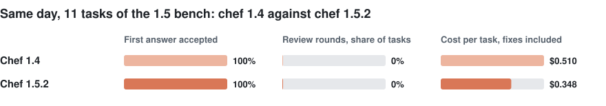
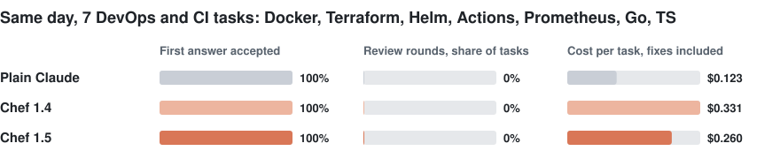
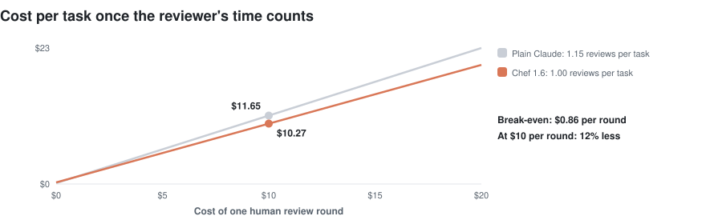
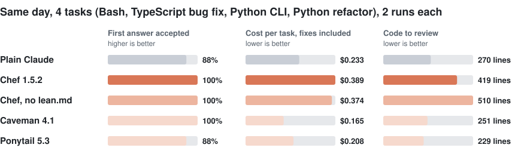

<p align="center">
  
</p>

<h1 align="center">Chef</h1>

<p align="center">
  <em>Your AI-powered coding chef crafting clean, secure, and maintainable code with precision</em>
</p>

<p align="center">
  
  
  
  
  
</p>

## Install

```
/plugin marketplace add Neotoxic-off/chef
```
```
/plugin install chef@chef
```

Chef then applies to every coding prompt.

## What chef does

- **Tests every change** and sets up a formatter, a linter and a strict type checker. Warnings get fixed, never hidden.
- **Types and pins:** every signature typed; dependencies, images and actions pinned.
- **Knows your stack:** 127 references (34 languages, frameworks, infra, CI).
- **Asks before guessing**, and remembers your answers in `.chef.md`. Your explicit instruction wins, never over security.
- **Brings a council** of agents for design decisions, and a reviewer for changes spanning several modules.
- **Talks less:** short replies, the smallest complete change ([`lean.md`](skills/chef/lean.md), adapted from [ponytail](https://github.com/DietrichGebert/ponytail), MIT).

## Results

A blind reviewer that never knows chef exists asks for fixes until it would merge. Same tasks, same model (Sonnet 5.5). [How it was measured](bench/README.md).

The model's behavior drifts from day to day: on 2026-11-25, plain Claude pinned to the same Claude Code 2.1.330 thought up to 100 times more than on 2026-11-22 and cost 1.5 to 3.3 times as much. Costs are only compared between arms run on the same day.

### Chef 1.5, same day as chef 1.4 and plain Claude (2026-11-25)

<p align="center">
  <picture>
    <source media="(prefers-color-scheme: dark)" srcset="assets/bench/overview-dark.svg">
    
  </picture>
</p>

<p align="center">
  <picture>
    <source media="(prefers-color-scheme: dark)" srcset="assets/bench/overview-152-dark.svg">
    
  </picture>
</p>

<p align="center">
  <picture>
    <source media="(prefers-color-scheme: dark)" srcset="assets/bench/devops-152-dark.svg">
    
  </picture>
</p>

Chef 1.5 costs 28% less than 1.4 on the 13 older tasks, 32% less on the 11 tasks of the 1.5 bench (cheaper on 10 of them) and 22% less on the DevOps and CI tasks; on the 11 tasks its first answer comes in 155 s instead of 210 s. Every first answer of both versions was accepted that day, against 92% and 82% for plain Claude, so these benches no longer separate 1.4 from 1.5 on quality.

<p align="center">
  <picture>
    <source media="(prefers-color-scheme: dark)" srcset="assets/bench/time-dark.svg">
    
  </picture>
</p>

Chef 1.5 is the cheaper option once a human review round costs more than $0.83.

<p align="center">
  <picture>
    <source media="(prefers-color-scheme: dark)" srcset="assets/bench/break-even-dark.svg">
    
  </picture>
</p>

Chef against caveman and ponytail, same day. Chef here is the 1.5 skill before its reviewer fix (`ad13bf7`), so its cost is an upper bound. With 2 runs per task, these are trends, not proof.

<p align="center">
  <picture>
    <source media="(prefers-color-scheme: dark)" srcset="assets/bench/styles-dark.svg">
    
  </picture>
</p>

Caveman and ponytail shorten replies and code, so they cost less than plain Claude; chef's extra cost buys the tests, linter and type checker it sets up and runs. `lean.md` cuts the code to review by about a fifth, at the same cost.

### The 1.5 bench, first 1.5 release (2026-11-22)

<p align="center">
  <picture>
    <source media="(prefers-color-scheme: dark)" srcset="assets/bench/overview-15-dark.svg">
    
  </picture>
</p>

| | Without chef | Chef 1.4 | Chef 1.5 |
|---|---|---|---|
| First answer accepted | 58% | 75% | **87%** |
| Review rounds per task | 0.53 | 0.33 | **0.15** |
| Cost per task, fixes included | $0.145 | $0.278 | $0.294 |
| Median time, first answer | 21 s | 65 s | 94 s |

Chef 1.5 against 1.4: +13 points (p = 0.04), with half the review rounds. Its first answer is slower: it now runs every check, from a container when a tool is missing.

Code quality per language: one task for each of the 32 most-used references, the mean of a blind reviewer's scores for quality, clarity, maintainability and functionality.

<p align="center">
  <picture>
    <source media="(prefers-color-scheme: dark)" srcset="assets/bench/quality-dark.svg">
    
  </picture>
</p>

### Across versions

Each version ran on its own day, so the costs are not comparable from one point to the next. The 1.5 point is its latest patch; it and plain Claude ran on 2026-11-25, a day the model thought far more than before (see above): plain Claude cost $0.137 per task that day, against $0.059 when the earlier versions ran.

<p align="center">
  <picture>
    <source media="(prefers-color-scheme: dark)" srcset="assets/bench/history-cost-dark.svg">
    
  </picture>
</p>

## Commands

| Command | |
|---|---|
| `/chef:level lite \| full \| max` | How much process: `lite` keeps every code rule, skips the council and reviewer. |
| `/chef:status` | Current level, project settings and detected stacks. |
| `/chef:transform <goal>` | Upgrade or migrate a codebase in small, tested batches. |

## Spend less

- `/chef:level lite` drops the council and the reviewer.
- Turn chef off in one project: `claude plugin disable chef@chef --scope local`.
- No plugin: copy [`export/AGENTS.md`](export/AGENTS.md), chef's core rules, into any agent's project.

## Change a rule

Edit [`skills/chef/SKILL.md`](skills/chef/SKILL.md) or a file in [`skills/chef/references/`](skills/chef/references/), then run `bash scripts/check.sh`. See the [CHANGELOG](CHANGELOG.md).
