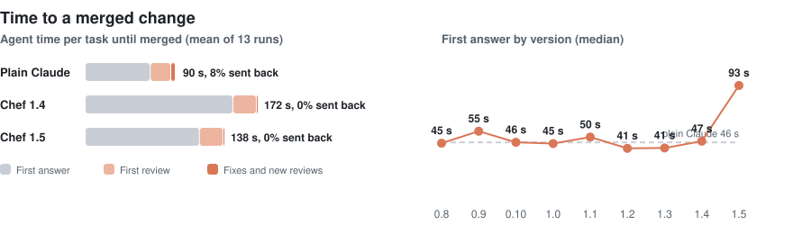
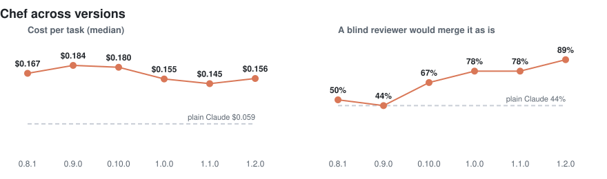

<p align="center">
  
</p>

<h1 align="center">Chef</h1>

<p align="center">
  <em>Your kitchen, your rules. Claude cooks the way you do.</em>
</p>

<p align="center">
  
  
  
  
</p>

**Chef makes Claude write code a reviewer accepts the first time.** It costs more tokens, and saves most of the review round-trips.

<p align="center">
  <picture>
    <source media="(prefers-color-scheme: dark)" srcset="assets/bench/overview-dark.svg">
    
  </picture>
</p>

| | Without chef | With chef |
|---|---|---|
| The reviewer accepts the first answer | 59% | **87%** |
| Tasks sent back for fixes | 41% | **13%** |
| Review rounds, as a share of tasks | 46% | **15%** (−67%) |
| Agent time per task, first answer | 21 s | 42 s (+100%) |
| Agent time per task, fixes and new reviews | 29 s | **11 s** (−62%) |
| Cost per task, review fixes included | $0.120 | $0.194 (**+62%**) |

<sub>13 tasks in 11 stacks, 3 runs each, Sonnet 5.5. The reviewer is a blind Opus session that never knows chef exists; when it would not merge, its required changes go back to the same setup, up to 2 rounds. The code works either way: every first answer passes its hidden tests. <a href="bench/README.md">How it was measured</a>.</sub>

Chef's first answer costs 129% more than a plain one, because it already does what the reviewer would ask for: tests, strict types and linters, pinned versions, configs checked by their tools. Counting the fixes plain Claude needs afterwards, the gap falls to +62%, for 67% fewer review rounds. In agent time the two end level (73 s and 79 s per task until merged, +8%); the difference is on the reviewer's side: 69% fewer tasks come back for another review.

<p align="center">
  <picture>
    <source media="(prefers-color-scheme: dark)" srcset="assets/bench/time-dark.svg">
    
  </picture>
</p>

Per token, chef is less cost-effective: $1 buys 8.2 accepted first answers without it and 5.3 with it. What it saves is the reviewer's rounds: 1.15 reviews per task instead of 1.46. Once a review round costs more than **$0.24** of the reviewer's time (about 15 seconds at $60/h), chef is the cheaper option; at $10 per round, $11.69 per task against $14.72 (−21%).

<p align="center">
  <picture>
    <source media="(prefers-color-scheme: dark)" srcset="assets/bench/break-even-dark.svg">
    
  </picture>
</p>

<sub>Reviews per task are the first review plus one after each fix. The model prices a round, not the lines in it: chef's code takes 2.3 times as many lines to read (median 231 against 98, lockfiles excluded).</sub>

## Install

```
/plugin marketplace add Neotoxic-off/chef
```
```
/plugin install chef@chef
```

That's it: chef applies to every coding prompt from now on.

## What chef does

- **Asks before guessing**, and remembers your answers in `.chef.md`.
- **Tests every change**, and sets up a formatter, a linter and a strict type checker. Warnings get fixed, never hidden.
- **Types every signature**, pins dependencies, images and actions.
- **Knows your stack:** 127 references (34 languages, frameworks, infra, CI) with the right tools and configs.
- **Brings a council** of agents for design decisions, and a reviewer for changes.

## Commands

| Command | |
|---|---|
| `/chef:level lite \| full \| max` | How much process: `lite` keeps every code rule but skips the council and reviewer. |
| `/chef:status` | Current level, project settings and detected stacks. |
| `/chef:transform <goal>` | Upgrade or migrate a codebase in small, tested, committed batches. |

## Spend less

- `/chef:level lite` drops the council and the reviewer agent, the biggest cost on large tasks.
- Or skip the plugin: copy [`export/AGENTS.md`](export/AGENTS.md), chef's 12 core rules, into your project. It works with any agent (Codex, Cursor, Copilot) and gets part of the effect (in the 1.0 benchmark: 56% merged as is against 89% with chef, at $0.084 per task).

## Change a rule

Edit [`skills/chef/SKILL.md`](skills/chef/SKILL.md) or a stack file in [`skills/chef/references/`](skills/chef/references/), then run `bash scripts/check.sh`. Changes are listed in the [CHANGELOG](CHANGELOG.md).

## Across versions

<p align="center">
  <picture>
    <source media="(prefers-color-scheme: dark)" srcset="assets/bench/history-dark.svg">
    
  </picture>
</p>

<sub>The three tasks every version was run on (Python CLI, Dockerfile + compose, Prometheus), same blind reviewer for every version, 6 to 9 reviews each: read it as a trend.</sub>
