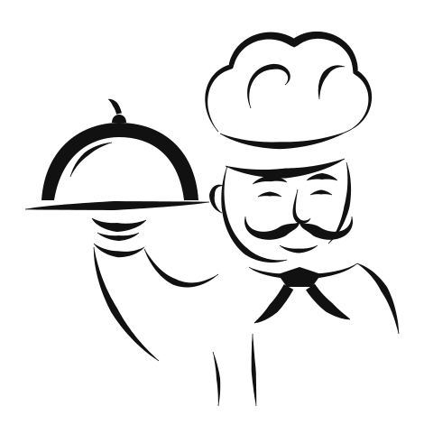

<p align="center">
  
</p>

<h1 align="center">Chef</h1>

<p align="center">
  <em>Your kitchen, your rules. Claude cooks the way you do.</em>
</p>

<p align="center">
  
  
  
  
  
</p>

## What it is

Chef is a [Claude Code](https://claude.com/claude-code) plugin that makes Claude follow one set of house coding habits on every task, in every project, without being reminded:

- **Priorities**: clarity, simplicity, maintainability, security. Too complex is wrong. Never assume, always verify.
- **Explicit types** on every variable, parameter, return and field, in every typed language.
- **SOLID**, readable code, few comments: if code needs many, it is not clear enough.
- **Tests**: unit and integration, 90% line and branch coverage gate, mutation testing on critical logic.
- **Never hide a warning or an error**: fix the cause, always.
- **WPF / WinUI**: CommunityToolkit, always.

Each stack has its own reference (linter, formatter, test runner, coverage tool, configs), loaded only when Claude works in it:

| Languages | DevOps and tools |
|---|---|
| C#/.NET, TypeScript/JS, Python, Rust, Go, C, C++, Java, Kotlin, Swift, Dart/Flutter, PHP, Ruby, Scala, Elixir, Lua, Bash, PowerShell, SQL | Docker, Kubernetes/Helm, Terraform/OpenTofu, CI/CD, Ansible, Git |

## Install

In Claude Code:

```
/plugin marketplace add Neotoxic-off/chef
/plugin install chef@chef
```


Update: `/plugin marketplace update chef`.

## Usage

Claude loads the skill by itself on coding tasks. To call it explicitly:

```
/chef:chef
```

To change a habit, edit [`skills/chef/SKILL.md`](skills/chef/SKILL.md) or the stack's file in [`skills/chef/references/`](skills/chef/references/), then push.
