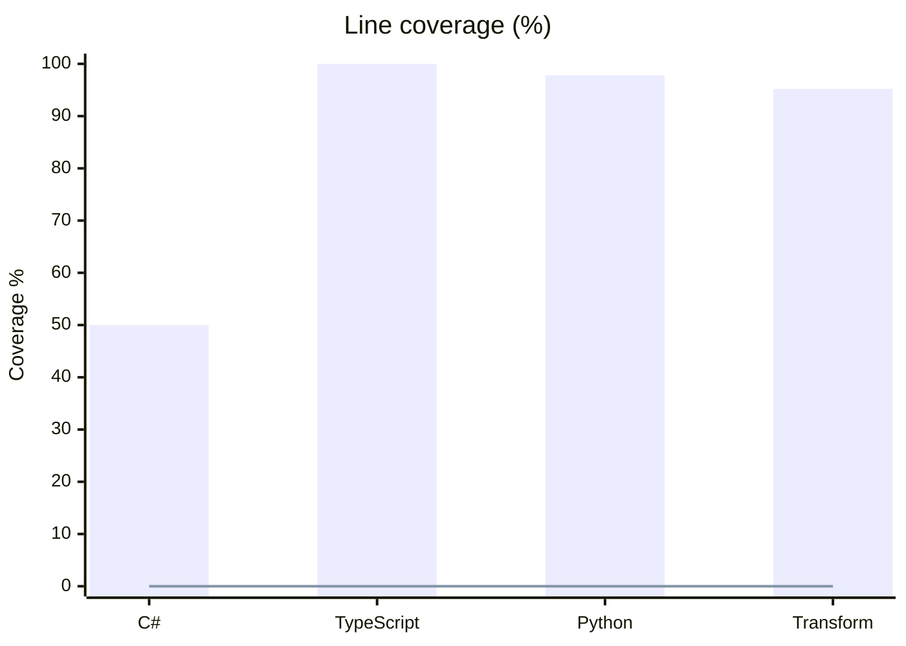
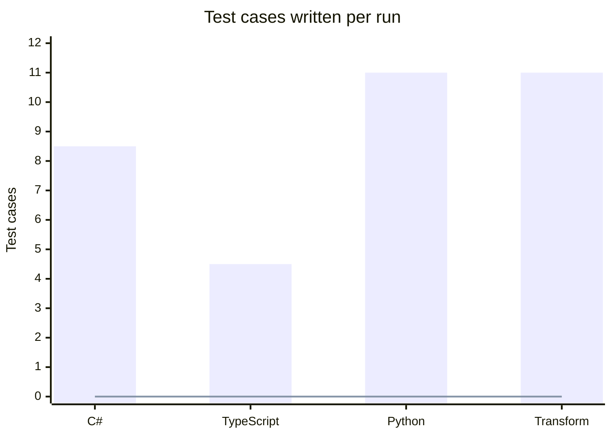
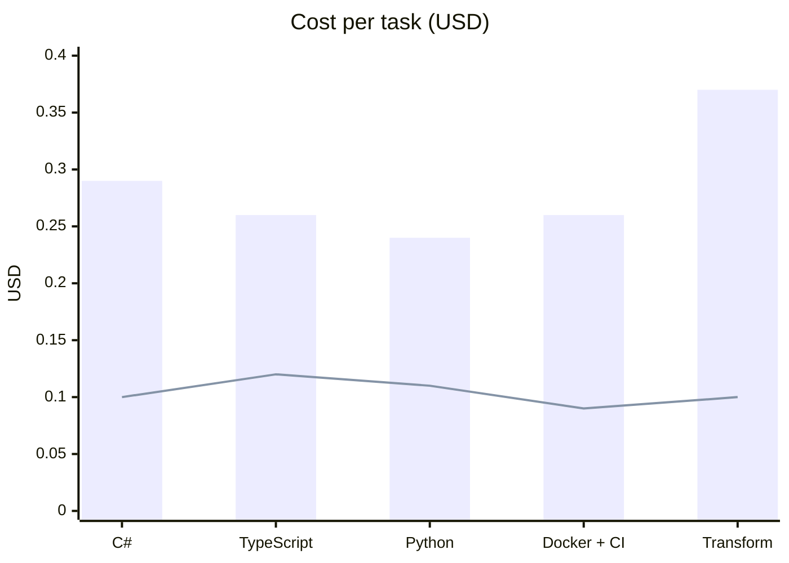
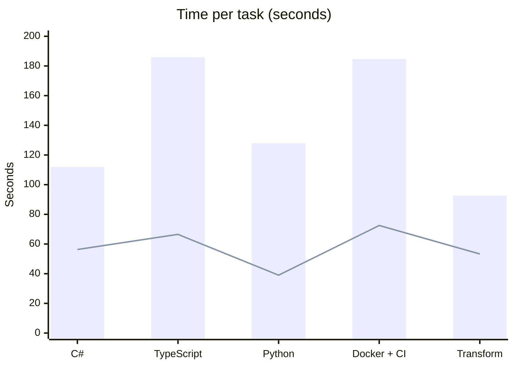
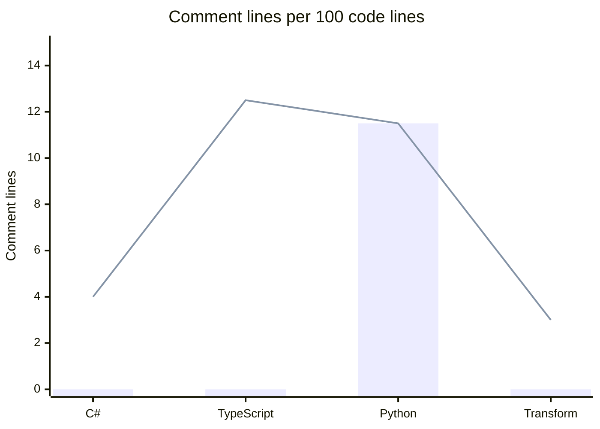

<p align="center">
  
</p>

<h1 align="center">Chef</h1>

<p align="center">
  <em>Your kitchen, your rules. Claude cooks the way you do.</em>
</p>

<p align="center">
  
  
  
  
  
</p>

## What it is

Chef is a [Claude Code](https://claude.com/claude-code) plugin that makes Claude follow one set of house coding habits on every task, in every project, without being reminded:

- **Priorities**: clarity, simplicity, maintainability, security. Too complex is wrong. Never assume, always verify.
- **Not sure? Ask.** Claude asks before guessing what you want.
- **Talk less, do what was asked**: answer first, no recap, no filler, no unrequested work.
- **Explicit types** on every variable, parameter, return and field, in every typed language.
- **SOLID**, readable code, few comments: if code needs many, it is not clear enough.
- **Tests**: unit and integration, 90% line and branch coverage gate, mutation testing on critical logic.
- **Never hide a warning or an error**: fix the cause, always. No suppression comments; lint rules that clash with these habits are turned off in config, with the reason.
- **`try`/`catch` only when nothing else works**: check first (`TryParse`, `dict.get`, `Result` types), except for files and network, where the operation itself is the check.
- **Strict mode**: on by default in new projects, asked first in existing ones.
- **Before heavy commands** (builds, test suites, installs): check free RAM and CPU first, and ask if the machine is loaded.
- **WPF / WinUI / MAUI / Avalonia**: CommunityToolkit, always.
- **Transform** (`/chef:transform <goal>`): upgrades and migrations in the AWS Transform style. Baseline, plan in a committed `TRANSFORM.md`, your approval, then small batches that are each validated, reviewed and committed.

Each stack has its own reference (linter, formatter, test runner, coverage tool, configs), loaded only when Claude works in it. Anything not listed is still covered: Claude looks up its official docs and standard tools first, then applies every rule.

| Area | Covered |
|---|---|
| Languages | C#/.NET, TypeScript/JS, Python, Rust, Go, C, C++, Java, Kotlin, Swift, Dart, PHP, Ruby, Scala, Elixir, Lua, Bash, PowerShell, SQL, Zig, Haskell, OCaml, F#, Clojure, Erlang, R, Julia, Perl, Objective-C, Solidity, WebAssembly, CUDA, embedded C/C++, VHDL/Verilog |
| Frontend | React, Next.js, Vue/Nuxt, Angular, Svelte/SvelteKit, Astro, React Router/Remix, SolidJS, Qwik, htmx, Blazor, Tailwind, Vite/webpack/Rolldown, Playwright/Cypress, Storybook |
| Backend | ASP.NET Core, NestJS/Express/Fastify, Django, FastAPI/Flask, Spring Boot, Laravel, Rails, Symfony, Phoenix, Axum/Actix, Go web, Ktor, Quarkus/Micronaut, Deno/Bun/Hono |
| Mobile, desktop, games | Flutter, React Native/Expo, Jetpack Compose, SwiftUI, WPF/WinUI, .NET MAUI, Avalonia, Electron, Tauri, Qt, Unity, Godot, Unreal |
| Cloud and infrastructure | Docker, Kubernetes/Helm, Terraform/OpenTofu, Pulumi, Bicep, AWS CDK, AWS, Azure, GCP, serverless, GitOps, secrets, Ansible, Nginx/Caddy/Traefik, Linux/systemd, Nix, service mesh, CI/CD, Git, Make/just, monorepos, config files |
| Observability | OpenTelemetry, Prometheus, Grafana, Loki, Tempo/Jaeger, logging, SLOs |
| Data and AI | PostgreSQL, Redis/Valkey, MongoDB, Kafka/RabbitMQ, Elasticsearch/OpenSearch, ORMs, pandas/Polars, notebooks, PyTorch/scikit-learn, LLM apps, Airflow/Dagster/dbt/Spark, Flink |
| Cross-cutting | REST/OpenAPI, GraphQL, gRPC, security (OWASP), accessibility (WCAG), i18n, WebSockets |
| Transformations | .NET Framework and .NET upgrades, Java and Spring Boot upgrades (OpenRewrite), Python version upgrades, TypeScript strict mode and Node/framework majors, raising test coverage to 90% |

## Council of agents

For decisions, new projects, new features and unclear requests, Claude acts as the lead and convenes a council from nine agents shipped with the plugin: three core members always, plus the two or three specialists the problem calls for. They work in parallel without seeing each other's answers, then cross-examine each other; the lead brings you the real choices.

| Agent | Seat | Role |
|---|---|---|
| `council-senior` | core | Knows the stack and the project; proposes the plan and what to reuse. |
| `council-skeptic` | core | Argues it will not work, with evidence, until the plan holds. |
| `council-novice` | core | Knows nothing; asks the simple questions about the need that experts skip. |
| `council-researcher` | specialist | Searches official docs, versions, known issues; cites every source. |
| `council-outsider` | specialist | Never reads the code; says what is correct and appropriate from first principles. |
| `council-security` | specialist | Attacks it: threat model, inputs, secrets, auth, supply chain. |
| `council-ops` | specialist | Runs it in production: deploy, observability, failure modes, rollback, cost. |
| `council-user` | specialist | Speaks for whoever uses the result: real need, UX, accessibility. |
| `council-maintainer` | specialist | Owns the code in two years: readability, tests, dependencies, cost of change. |

One more agent, `reviewer`, did not write the code: it checks the changes against the house rules before you see them. Every working agent ends with the same report: done, files, checks, not verified, risks, questions.

## Install

In Claude Code:

```
/plugin marketplace add Neotoxic-off/chef
/plugin install chef@chef
```

Update: `/plugin marketplace update chef`, then `/reload-plugins`.

## Usage

A `UserPromptSubmit` hook reminds Claude, on every prompt, to load the skill before the first edit or command of any development task. To call it explicitly:

```
/chef:chef
```

To upgrade or migrate a repository (.NET, Java, Python, Node versions, TypeScript strict mode, test coverage), run:

```
/chef:transform <goal>
```

It works like AWS Transform, inside one repository: it measures a baseline build and test run, writes a plan of small batches to `TRANSFORM.md`, has the council check it, and waits for your approval. Then each batch is edited, validated, reviewed and committed. A Stop hook, active only during a transform, keeps Claude from stopping while a batch is edited but not validated. The plan is committed, so a later session resumes where it stopped. Mainframe, VMware and multi-repo migrations are out of scope.

To pick how much ceremony chef uses, per project:

```
/chef:level lite|full|max
/chef:status
```

| Level | What changes |
|---|---|
| `lite` | Every code rule (types, tests, lint, security), no council, no reviewer agent. Cheapest. |
| `full` | Default. Council for decisions, reviewer on changes. |
| `max` | Council on every non-trivial change, reviewer always. |

The level and other answers (strict mode, coverage target, council on or off) are kept in `.chef.md` at the project root, so chef does not ask twice. `/chef:status` shows the level, the overrides, the detected stacks and the session's token use.

Two Stop hooks check what prose rules could not enforce. `pin-gate.sh` blocks once if a changed GitHub workflow uses an action not pinned by commit SHA. During `/chef:transform`, the stop gate requires a `Target:` runtime, a `## Council` section and one commit per ticked batch.

To change a habit, edit [`skills/chef/SKILL.md`](skills/chef/SKILL.md) or the stack's file in [`skills/chef/references/`](skills/chef/references/) (listed in [`INDEX.md`](skills/chef/references/INDEX.md)). Run `bash scripts/check.sh` before you push; CI runs it too.

## With and without chef

Same prompt, same model (Sonnet 5.5): *"Create a Python command-line tool that reads a TOML config file containing a list of endpoints (url, timeout in seconds), validates it, and prints which entries are invalid and why."* Below, the URL check from each output, unedited.

**Without chef**: one 50-line `validate_entry` doing everything, no types, section comments, no tests, no lint config.

```python
def validate_entry(entry):
    """Return a list of problems for one endpoint entry (empty if valid)."""
    if not isinstance(entry, dict):
        return [f"entry must be a table, got {type(entry).__name__}"]

    problems = []

    for key in entry.keys() - {"url", "timeout"}:
        problems.append(f"unknown key '{key}'")

    # url
    if "url" not in entry:
        problems.append("missing 'url'")
    else:
        url = entry["url"]
        if not isinstance(url, str):
            problems.append(f"'url' must be a string, got {type(url).__name__}")
        elif not url.strip():
            problems.append("'url' is empty")
        else:
            try:
                parts = urlsplit(url)
                host = parts.hostname
                parts.port  # raises ValueError if out of range / not numeric
            except ValueError as exc:
                problems.append(f"'url' is malformed ({exc})")
            else:
                if parts.scheme.lower() not in ALLOWED_SCHEMES:
                    ...
    # timeout
    ...
```

**With chef**: one small typed function per check, early returns, named constants, plus `pyproject.toml` with Ruff and `mypy --strict`, and 37 pytest tests that pass with 99% coverage.

```python
ENDPOINTS_KEY: str = "endpoints"
ALLOWED_SCHEMES: frozenset[str] = frozenset({"http", "https"})
ALLOWED_KEYS: frozenset[str] = frozenset({"url", "timeout"})

EXIT_OK: int = 0
EXIT_INVALID_ENTRIES: int = 1
EXIT_UNREADABLE: int = 2


@dataclass(frozen=True, slots=True)
class Issue:
    location: str
    reason: str


def validate_url(value: object) -> str | None:
    """Return why the URL is invalid, or None when it is valid."""
    if not isinstance(value, str):
        return f"url must be a string, got {type(value).__name__}"
    if not value.strip():
        return "url is empty"
    if any(char.isspace() for char in value):
        return "url must not contain whitespace"
    return validate_url_parts(value)


def validate_url_parts(url: str) -> str | None:
    try:
        parts: SplitResult = urlsplit(url)
        hostname: str | None = parts.hostname
        port: int | None = parts.port
    except ValueError as error:
        return f"url is malformed ({error})"
    if parts.scheme not in ALLOWED_SCHEMES:
        return f"url scheme must be http or https, got {parts.scheme or 'none'!r}"
    if not hostname:
        return "url has no host"
    if port == 0:
        return "url port must not be 0"
    return None
```

## Benchmark

Same prompt, same model (Sonnet 5.5), fresh git folder each time. The only difference: the chef plugin. Every other plugin is off in both arms. 5 tasks × 2 runs per arm, run on Nov 19, 2026.

Every result is checked by running real tools on the output, with the same settings for both arms:

- **Hidden tests:** each prompt names a function, and after the run a test Claude never saw calls it.
- **Strict checkers:** `mypy --strict`, `tsc --strict`, compiler warnings, ruff and hadolint.
- **Coverage:** measured line coverage of the project's own tests.

### At a glance

Share of runs that meet each check, across all tasks it applies to.

| Check | Without chef | With chef |
|---|---|---|
| **Correct**: hidden tests pass (8 code runs) | `████████████████████` 100% | `████████████████████` 100% |
| **Tested**: tests written and passing (8 code runs) | `░░░░░░░░░░░░░░░░░░░░` 0% | `██████████████████░░` 88% |
| **Covered**: average line coverage (8 code runs) | `░░░░░░░░░░░░░░░░░░░░` 0% | `█████████████████░░░` 86% |
| **Typed**: no inferred or unannotated declarations (C#, TS, Python) | `░░░░░░░░░░░░░░░░░░░░` 0% | `█████████████████░░░` 83% |
| **Clean under strict checkers**: 0 compiler warnings, `tsc --strict`, `mypy --strict` errors | `█████████████░░░░░░░` 67% | `████████████████████` 100% |
| **Strict tooling set up**: warnings as errors, ESLint, Ruff + strict type checker | `░░░░░░░░░░░░░░░░░░░░` 0% | `████████████████████` 100% |
| **Hardened container and CI**: 7 checks per run (digest, healthcheck, permissions, ...) | `██████████░░░░░░░░░░` 50% | `█████████████████░░░` 86% |
| **Safe migration**: tests first, plan, commits per batch, review | `░░░░░░░░░░░░░░░░░░░░` 0% | `██████████████████░░` 88% |

Both arms write code that works. The difference is everything around it: tests, coverage, types and strict tooling.

In the charts below, bars are with chef and the line is without.











Fewer comments is the intended effect: chef's rule is self-explaining code, with comments only for a non-obvious *why*.

### Comparison: new code

| Task | Metric | Without chef | With chef |
|---|---|---|---|
| C# library | Hidden tests pass | 2/2 | 2/2 |
| | Test cases written | 0 | 8.5 |
| | Tests pass | no tests | 1/2 |
| | Line coverage | 0% | 100% / 0% |
| | `var` (inferred types) | 2 | 0 |
| | Build warnings | 0 | 0 |
| | `TreatWarningsAsErrors` | 0/2 | 2/2 |
| TypeScript module | Hidden tests pass | 2/2 | 2/2 |
| | Test cases written | 0 | 4.5 |
| | Line coverage | 0% | 100% |
| | Untyped `const`/`let` | 4.5 | 0.5 |
| | `tsc --strict` errors | 0 | 0 |
| | ESLint config | 0/2 | 2/2 |
| Python CLI | Hidden tests pass | 2/2 | 2/2 |
| | Test cases written | 0 | 11 |
| | Line coverage | 0% | 97.8% |
| | `mypy --strict` errors | 2 | 0 |
| | Ruff findings (default rules) | 3 | 2 |
| | Ruff + strict type checker config | 0/2 | 2/2 |
| Dockerfile + CI | `HEALTHCHECK`, base image pinned by digest | 0/2 | 2/2 |
| | `permissions:` block | 1/2 | 2/2 |
| | Actions pinned by SHA | 0/2 | 0/2 |
| | Hadolint findings | 1 | 1 |
| All four | Cost per task | $0.09–0.12 | $0.24–0.29 |
| | Time per task | 39–73 s | 112–186 s |

### Transformation: Python 3.8 to 3.13

The seed is a small legacy module with no tests. It uses `distutils.util.strtobool`, `datetime.utcnow()`, `typing.List` and `python_requires=">=3.8"`. Prompt: upgrade it to Python 3.13, keep the public functions and their behavior. With chef, the same prompt starts with `/chef:transform`. The hidden test runs on Python 3.13 with `DeprecationWarning` as an error. The untouched seed fails it.

| Metric | Without chef | With chef |
|---|---|---|
| Hidden tests pass on 3.13 | 2/2 | 2/2 |
| `distutils` and `utcnow()` removed, `python_requires>=3.13` | 2/2 | 2/2 |
| Characterization tests written | 0 | 11, all pass |
| Line coverage | 0% | 95.2% |
| `TRANSFORM.md` with baseline, batches and report | 0/2 | 2/2 |
| Commits | 0 | 4 |
| `reviewer` agent on the diff | 0/2 | 1/2 |
| Council on the plan | 0/2 | 0/2 |
| Cost per task | $0.10 | $0.37 |

### Takeaways

Without chef, Claude writes working code with no tests at all, in every run. With chef, the same code ships with tests (86% average line coverage), explicit types and strict tooling. It costs about 2.5× more (3.7× for a transformation) and takes 1.7–3.3× as long.

Weak spots seen:

- **C# run without tests:** in one run, the `dotnet add package` calls never reached the test project, so its tests do not build.
- **Actions not pinned by SHA:** they are still pinned by tag only, even though the rule is in `ci.md`.
- **Transform steps skipped:** `/chef:transform` never convened the council and ran the reviewer in only one run of two.

These steps are written rules that the model skipped. Hook-based gates are planned to enforce them.

Limits:

- 2 runs per arm is a small sample.
- Times are inflated by the checks running in parallel on the same machine. Compare the arms, not the absolute seconds.
- `docker build` and actionlint were not run.
- The harness is not in the repo.
