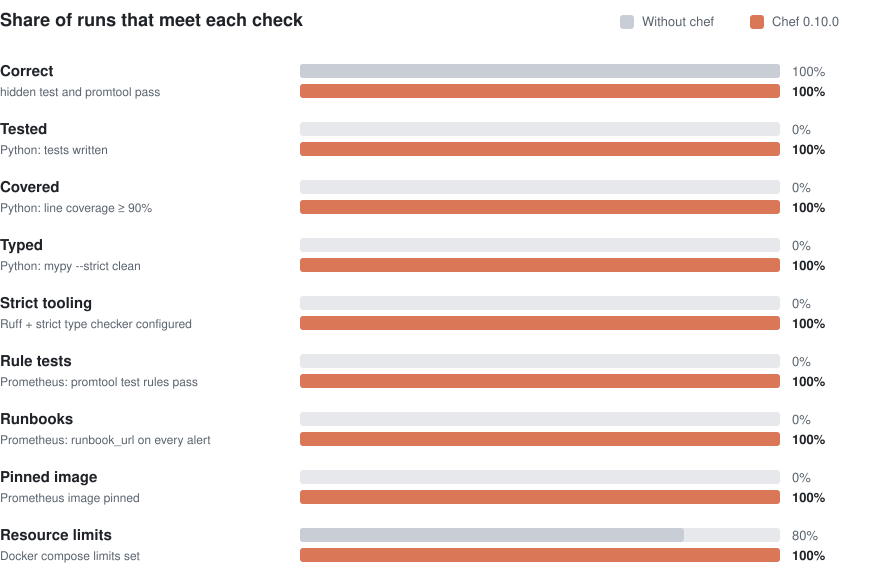
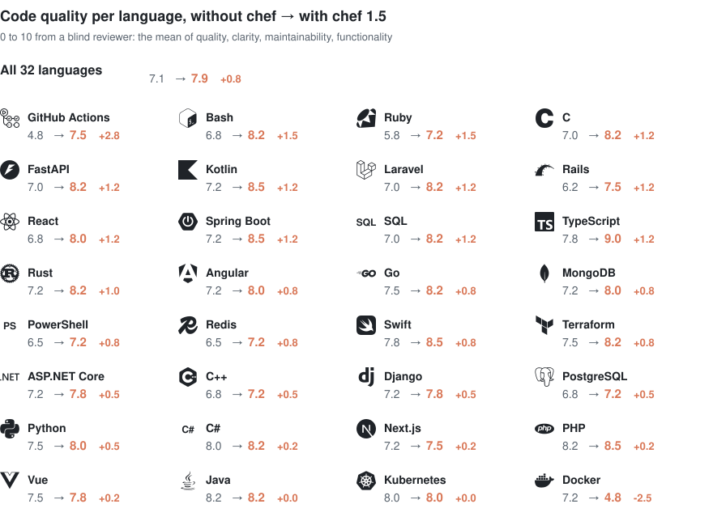

<p align="center">
  
</p>

<h1 align="center">Chef</h1>

<p align="center">
  <em>Your kitchen, your rules. Claude cooks the way you do.</em>
</p>

<p align="center">
  
  
  
  
  
</p>

<p align="center">
  <strong>Tested code in 100% of the code runs, without chef 0%.</strong><br>
  <strong>98% line coverage &middot; explicit types &middot; strict linters &middot; pinned images &middot; tested alert rules</strong><br>
  <strong>And the output works either way:</strong> hidden tests and promtool pass in 100% of runs, with or without chef.<br>
  <strong>The price: about 2.4–3.5× the cost of a plain run.</strong> v0.10 trims it by about 5%.<br>
  <sub>Benchmarked in Claude Code, the same agent with and without the plugin: 3 tasks, Sonnet 5.5, 5 runs per arm, every result checked by real tools. <a href="#numbers">Details</a>.</sub>
</p>

---

You know the kitchen. Every pan has its place, every dish is tasted before it leaves, nobody hides a burnt sauce under parsley. Chef puts that kitchen inside Claude Code: one set of house habits, applied on every task, in every project, without being reminded.

## Numbers

<p align="center">
  <picture>
    <source media="(prefers-color-scheme: dark)" srcset="assets/bench/scorecard-dark.svg">
    
  </picture>
</p>

<details>
<summary><strong>All checks, with chef 0.9.0</strong></summary>

Share of runs that meet each check, 5 runs per arm.

| Check | Without chef | Chef 0.9.0 | Chef 0.10.0 |
|---|---|---|---|
| Works: hidden test passes, `promtool check config` and `check rules` pass | 100% | 100% | 100% |
| Python: tests written (median) | 0 | 33 | 29 |
| Python: line coverage (median) | 0% | 98.4% | 98.4% |
| Python: `mypy --strict` errors (median) | 1 | 0 | 0 |
| Python: Ruff and strict type checker configured | 0% | 100% | 100% |
| Docker: non-root user, healthcheck, `.dockerignore`, hardened compose | 100% | 100% | 100% |
| Docker: compose resource limits | 80% | 100% | 100% |
| Docker: base image pinned by digest | 0% | 40% | 40% |
| Docker: hadolint findings (median) | 0 | 0 | 0 |
| Prometheus: alert rule unit tests (`promtool test rules`), passing | 0% | 100% | 100% |
| Prometheus: every alert has `runbook_url` | 0% | 100% | 100% |
| Prometheus: Prometheus image pinned | 0% | 100% | 100% |

</details>

Without chef, Claude writes code and config that work, and nothing around them: no tests, no rule tests, unpinned images, no strict tooling. With chef, the same output ships with tests, coverage, explicit types, pinned images and tested alert rules. The digest pin fell from 100% in the previous run to 40% in both chef arms; Docker Hub was answering `429 Too Many Requests` during this run, which can block the digest lookup (not verified run by run).

### Cost

<p align="center">
  <picture>
    <source media="(prefers-color-scheme: dark)" srcset="assets/bench/cost-dark.svg">
    
  </picture>
</p>

Median per task, with the min–max over 5 runs. Cost is what `claude -p` reports in `total_cost_usd`.

| Task | Without chef | Chef 0.9.0 | Chef 0.10.0 |
|---|---|---|---|
| Python CLI | $0.060 (0.055–0.063) | $0.211 (0.181–0.271) | $0.192 (0.167–0.247) |
| Dockerfile + compose | $0.051 (0.049–0.091) | $0.128 (0.115–0.139) | $0.128 (0.118–0.136) |
| Prometheus | $0.081 (0.061–0.091) | $0.189 (0.183–0.209) | $0.183 (0.167–0.201) |
| **Sum of medians** | **$0.192** | **$0.528** | **$0.503 (−5%)** |
| Turns, median (Python / Docker / Prometheus) | 3 / 3 / 6 | 15 / 12 / 13 | 13 / 11 / 12 |

The ranges of 0.9.0 and 0.10.0 overlap on every task, so the −5% is a trend, not a proven saving.

**What the extra cost buys.** The same tasks and runs, scored on quality: the share of each task's checks that pass, averaged over 5 runs.

<p align="center">
  <picture>
    <source media="(prefers-color-scheme: dark)" srcset="assets/bench/quality-dark.svg">
    
  </picture>
</p>

| Task | Checks counted | Without chef | Chef 0.10.0 |
|---|---|---|---|
| Python CLI | 6: hidden test, tests written, coverage ≥ 90%, `mypy --strict` clean, Ruff clean, strict tool config | 27% | 97% |
| Dockerfile + compose | 8: digest pin, non-root, healthcheck, `.dockerignore`, valid compose, hardened compose, resource limits, hadolint clean | 85% | 92% |
| Prometheus | 10: config valid, rules valid, `histogram_quantile`, `for`, `severity`, `summary`, `runbook_url` on every alert, rule tests pass, valid compose, pinned image | 70% | 100% |

So chef costs about 2.5× per task, and the first answer is the finished one: tested, typed, pinned, with tested alert rules. Without chef, the code works but the missing tests, types, pins and rule tests are left for a follow-up prompt or a review. The cost of those follow-ups was not measured here.

**Where the money goes.** A per-call trace of one chef run (Prometheus, $0.239) splits as follows, with the official cache multipliers for Sonnet 5.5 (1-hour cache write 2× input, cache read 0.05× input):

<p align="center">
  <picture>
    <source media="(prefers-color-scheme: dark)" srcset="assets/bench/cost-split-dark.svg">
    
  </picture>
</p>

So the extra cost of chef is mostly the extra work: more files written, more checks run, and their output entering the context. The rules text is a small part. Counting cache reads as "tokens" overstates the cost: the previous README did, and its "−11% tokens" for 0.9.0 was within noise.

**What 0.10.0 changes.**

- The skill gives the exact path of its references (`${CLAUDE_SKILL_DIR}/references/INDEX.md`) and forbids listing the folder. One traced 0.9.0 run spent 16k characters on such a listing; none of the 30 chef runs here did, so this guards a rare case.
- A "Few tokens" section: one call per stack check, quiet flags, batched reads and writes, no read-back of a file just written.
- One-call check commands in `python.md`, `docker.md`, `prometheus.md` and `ci.md` that fail if any tool fails, with promtool and hadolint from their images when not installed.
- `scripts/check.sh` fails if `SKILL.md` grows past 10.5 KB, or any reference or `team.md` past 6 KB.

Every result is checked by running tools on the output, with the agent's own tool config ignored: a hidden test that calls the function the prompt asked for, `promtool check config`, `check rules` and `test rules`, `mypy --strict`, Ruff, hadolint, and measured line coverage. See [Benchmark details](#benchmark-details).

## Before / after

Same prompt: *"Create a Python command-line tool that reads a TOML config file containing a list of endpoints (url, timeout in seconds), validates it, and prints which entries are invalid and why."* The URL check from each output, unedited.

<table>
<tr><th>Without chef</th><th>With chef</th></tr>
<tr><td valign="top">

One 50-line function doing everything, no types, section comments, no tests, no lint config.

```python
def validate_entry(entry):
    """Return a list of problems for one
    endpoint entry (empty if valid)."""
    if not isinstance(entry, dict):
        return [f"entry must be a table, ..."]

    problems = []

    for key in entry.keys() - {"url", "timeout"}:
        problems.append(f"unknown key '{key}'")

    # url
    if "url" not in entry:
        problems.append("missing 'url'")
    else:
        url = entry["url"]
        if not isinstance(url, str):
            problems.append(f"'url' must be ...")
        elif not url.strip():
            problems.append("'url' is empty")
        else:
            try:
                parts = urlsplit(url)
                host = parts.hostname
                parts.port  # raises ValueError
            except ValueError as exc:
                problems.append(f"malformed ({exc})")
            ...
    # timeout
    ...
```

</td><td valign="top">

One small typed function per check, early returns, named constants. Plus Ruff, `mypy --strict`, and 37 tests at 99% coverage.

```python
ALLOWED_SCHEMES: frozenset[str] = frozenset(
    {"http", "https"})


def validate_url(value: object) -> str | None:
    if not isinstance(value, str):
        return f"url must be a string, ..."
    if not value.strip():
        return "url is empty"
    if any(char.isspace() for char in value):
        return "url must not contain whitespace"
    return validate_url_parts(value)


def validate_url_parts(url: str) -> str | None:
    try:
        parts: SplitResult = urlsplit(url)
        hostname: str | None = parts.hostname
        port: int | None = parts.port
    except ValueError as error:
        return f"url is malformed ({error})"
    if parts.scheme not in ALLOWED_SCHEMES:
        return f"url scheme must be http or https"
    if not hostname:
        return "url has no host"
    if port == 0:
        return "url port must not be 0"
    return None
```

</td></tr>
</table>

## How it works

The house rules, in priority order: **clarity, simplicity, maintainability, security.** Security is never traded away.

- **Not sure? Ask.** Claude asks before guessing what you want, and remembers the answer in `.chef.md`.
- **Talk less.** Result first, about 10 lines, then what was skipped and the risk. No recap, no filler.
- **Explicit types** on every variable, parameter, return and field, in every typed language.
- **Tests with every change:** unit and integration, a 90% line and branch coverage gate, mutation testing on critical logic.
- **Never hide a warning.** Fix the cause. No suppression comments, no `|| true`, no lowered thresholds.
- **SOLID, few comments.** If code needs many, it is not clear enough.
- **`try`/`catch` only when nothing else works:** check first (`TryParse`, `dict.get`, `Result`), except for files and network.
- **Before heavy commands** (builds, test suites, installs): check free RAM and CPU first.

Each stack has its own reference (linter, formatter, test runner, coverage tool, configs), loaded only when Claude works in it. A stack not listed is still covered: Claude looks up its official tools first, then applies every rule.

**Rules the model skips are enforced by hooks.** `pin-gate.sh` blocks once per session if a GitHub workflow Claude edited uses an action not pinned by commit SHA; workflows you edit yourself are not checked. During `/chef:transform`, a stop gate requires a `Target:` runtime, a `## Council` section, and one commit per ticked batch.

### The council

For decisions, new projects and unclear requests, Claude acts as the lead and convenes a council: three core members always, plus the two or three specialists the problem calls for. They answer in parallel without seeing each other, then cross-examine; the lead brings you the real choices.

| Agent | Seat | Role |
|---|---|---|
| `council-senior` | core | Knows the stack and the project; proposes the plan and what to reuse. |
| `council-skeptic` | core | Argues it will not work, with evidence, until the plan holds. |
| `council-novice` | core | Knows nothing; asks the simple questions experts skip. |
| `council-researcher` | specialist | Official docs, versions, known issues; cites every source. |
| `council-outsider` | specialist | Never reads the code; reasons from first principles. |
| `council-security` | specialist | Threat model, inputs, secrets, auth, supply chain. |
| `council-ops` | specialist | Deploy, observability, failure modes, rollback, cost. |
| `council-user` | specialist | The real need of whoever uses the result: UX, accessibility. |
| `council-maintainer` | specialist | Owns the code in two years: readability, tests, cost of change. |

One more agent, `reviewer`, did not write the code: it checks every change against the house rules before you see it.

## Install

In Claude Code, as two separate prompts:

```
/plugin marketplace add Neotoxic-off/chef
```
```
/plugin install chef@chef
```

Update: `/plugin marketplace update chef`, then `/reload-plugins`.

That's it. A `UserPromptSubmit` hook routes every development prompt through chef from now on.

## Commands

| Command | What it does |
|---|---|
| `/chef:chef` | Load the house rules now. Usually not needed: the hook does it on every development prompt. |
| `/chef:level [lite \| full \| max]` | Set how much ceremony chef uses in this project, saved in `.chef.md`. No argument shows the current level. |
| `/chef:status` | The active level, the `.chef.md` overrides, the detected stacks, and this session's tokens, subagents and time. |
| `/chef:transform <goal>` | Upgrade or migrate the repo in small batches: baseline, plan in `TRANSFORM.md`, council, your approval, then each batch validated, reviewed and committed. Resumes where it stopped. |

| Level | What changes |
|---|---|
| `lite` | Every code rule (types, tests, lint, security). No council, no reviewer agent. Cheapest. |
| `full` | Default. Council for decisions, reviewer on changes. |
| `max` | Council on every non-trivial change, reviewer always. |

## Stacks covered

| Area | Covered |
|---|---|
| Languages | C#/.NET, TypeScript/JS, Python, Rust, Go, C, C++, Java, Kotlin, Swift, Dart, PHP, Ruby, Scala, Elixir, Lua, Bash, PowerShell, SQL, Zig, Haskell, OCaml, F#, Clojure, Erlang, R, Julia, Perl, Objective-C, Solidity, WebAssembly, CUDA, embedded C/C++, VHDL/Verilog |
| Frontend | React, Next.js, Vue/Nuxt, Angular, Svelte/SvelteKit, Astro, React Router/Remix, SolidJS, Qwik, htmx, Blazor, Tailwind, Vite/webpack/Rolldown, Playwright/Cypress, Storybook |
| Backend | ASP.NET Core, NestJS/Express/Fastify, Django, FastAPI/Flask, Spring Boot, Laravel, Rails, Symfony, Phoenix, Axum/Actix, Go web, Ktor, Quarkus/Micronaut, Deno/Bun/Hono |
| Mobile, desktop, games | Flutter, React Native/Expo, Jetpack Compose, SwiftUI, WPF/WinUI, .NET MAUI, Avalonia, Electron, Tauri, Qt, Unity, Godot, Unreal |
| Cloud and infrastructure | Docker, Kubernetes/Helm, Terraform/OpenTofu, Pulumi, Bicep, AWS CDK, AWS, Azure, GCP, serverless, GitOps, secrets, Ansible, Nginx/Caddy/Traefik, Linux/systemd, Nix, service mesh, CI/CD, Git, Make/just, monorepos, config files |
| Observability | OpenTelemetry, Prometheus, Grafana, Loki, Tempo/Jaeger, logging, SLOs |
| Data and AI | PostgreSQL, Redis/Valkey, MongoDB, Kafka/RabbitMQ, Elasticsearch/OpenSearch, ORMs, pandas/Polars, notebooks, PyTorch/scikit-learn, LLM apps, Airflow/Dagster/dbt/Spark, Flink |
| Cross-cutting | REST/OpenAPI, GraphQL, gRPC, security (OWASP), accessibility (WCAG), i18n, WebSockets |
| Transformations | .NET Framework and .NET upgrades, Java and Spring Boot upgrades (OpenRewrite), Python version upgrades, TypeScript strict mode and Node/framework majors, raising test coverage to 90% |

## FAQ

**Does it need a config file?**
No. `.chef.md` at the project root is created only when you set a level or answer a question chef would otherwise ask again. Commit it to share the choices with your team.

**It costs more. Can I turn it down?**
`/chef:level lite` keeps every code rule but drops the council and the reviewer agent, the biggest extra cost on large tasks. On small tasks, most of the extra cost is the tests and checks themselves (see [Cost](#cost)).

**Will it rewrite my legacy code?**
No. Its style rules apply to the lines it adds or must change. Strict mode is asked first in an existing project, and `/chef:transform` keeps the diff to what the migration needs.

**How do I change a habit?**
Edit [`skills/chef/SKILL.md`](skills/chef/SKILL.md), or the stack's file in [`skills/chef/references/`](skills/chef/references/) (listed in [`INDEX.md`](skills/chef/references/INDEX.md)). Run `bash scripts/check.sh` before you push; CI runs it too.

**Why "chef"?**
Because the kitchen has rules, and the dish is tasted before it leaves.

## Benchmark details

Same prompt, same model (Sonnet 5.5), fresh git folder each time, run on Nov 19, 2026 with Claude Code 2.1.328. For each task and run, the three arms run side by side: no plugin, chef 0.9.0 and chef 0.10.0. User settings, other plugins and MCP servers are off in every arm (`--setting-sources project --strict-mcp-config`); only the chef arms get `--plugin-dir`. Each prompt ends with "Work autonomously: nobody will answer questions."

The harness is in [`bench/`](bench/):

```bash
bash bench/run.sh <new-out-dir> 5 none= old=<chef-0.9.0-dir> new=<chef-dir>
python bench/score.py <out-dir> > scores.json
```

`run.sh` keeps each run's `stream.jsonl` (every call, tool and usage) and writes `versions.txt`. `score.py` needs pytest, pytest-cov, mypy, Ruff, PyYAML and a running Docker daemon (hadolint and promtool run from their official images). It reports the median for measurements, the share of runs for checks, and cache writes, cache reads, output tokens, tool calls and tool output size separately.

| Task | Prompt, in short | What is checked |
|---|---|---|
| Python CLI | TOML endpoint validator, `find_invalid(path)` in `endpoints.py` | Hidden pytest, tests written, line coverage, `mypy --strict`, Ruff, tool config |
| Dockerfile + compose | Containerize a stdlib HTTP service with `/health` | `docker build` and `/health`, hadolint, digest pin, non-root, healthcheck, `.dockerignore`, `docker compose config`, `read_only` + `no-new-privileges` or `cap_drop: ALL`, resource limits |
| Prometheus | Scrape config, alerts for down, 5xx ratio > 5%, p95 > 500 ms, compose | `promtool check config --syntax-only`, `check rules`, `test rules`, `for`, `severity`, `summary`, `runbook_url`, `histogram_quantile` on `_bucket`, pinned image |

<details>
<summary><strong>Weak spots and limits</strong></summary>

- 5 runs per arm shows trends, not proof: at this variance, a 10% effect needs far more runs. Claim a saving only when the ranges stop overlapping.
- Docker Hub rate-limited this machine (`429 Too Many Requests`) during the runs and the scoring, so `docker build` failed in most Docker runs. The container health check is not reported here; in the previous run every Docker output built and answered `/health`, with and without chef.
- The 0.10.0 arm ran a snapshot taken just before a final review pass. That pass only changed the wording of the one-call check commands (exit code, hadolint config mount), not their length.
- The cost split comes from one traced run and uses Sonnet 5.5 base prices from third-party pages; the multipliers are official.
- No run used subagents, so these tasks measure the rules, not the council or the reviewer.
- Times are inflated by three runs in parallel on the same machine. Compare the arms, not the absolute seconds.
- Earlier benchmarks (0.8.1 with five tasks, and 0.8.1 vs 0.9.0 with 2 runs) are in the git history of this README.

</details>
