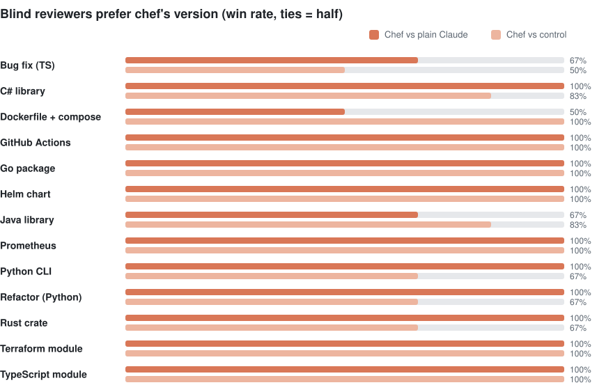
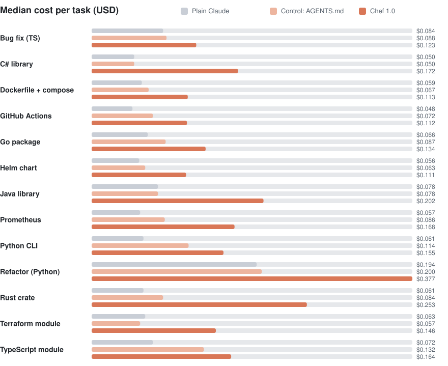
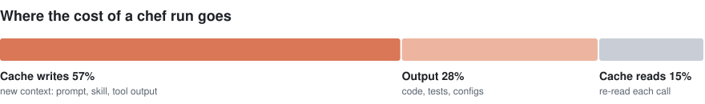

# Chef benchmark

How chef was measured, task by task. The short version is in the [main README](../README.md).

## Cost to mergeable (1.2)

The headline numbers in the README. Same 13 tasks as below, 39 runs per arm: plain Claude and chef 1.1 reuse their first answers from the 1.1 run, chef 1.2 is new (Claude Code 2.1.328 and 2.1.329). A blind Opus reviewer, the same panel prompt as in [`judge.md`](judge.md), decides whether it would merge each first answer and lists the changes it requires (`blocker` or `major`). If it would not merge, those changes go back as a new prompt to the same setup in that workspace, and a fresh reviewer looks again, up to 2 fix rounds. The reviewer's copy follows `.gitignore`, so every arm was reviewed again with it. Harness: [`merge_loop.py`](merge_loop.py), results: [`results/merge.json`](results/merge.json).

| | Plain Claude | Chef 1.1 | Chef 1.2 |
|---|---|---|---|
| First answer accepted | 59% | 85% | 87% |
| Merged after at most 2 fix rounds | 97% | 100% | 100% |
| Fix rounds per task | 0.46 | 0.23 | 0.15 |
| First answers, cost of 39 runs | $2.82 | $6.33 | $6.47 |
| With the fixes | $4.68 | $7.29 | $7.56 |

Reviewer costs ($4.36, $4.50 and $4.04) are not counted in any arm. Agent time in the README is the mean of each step's `duration_ms` over the 39 tasks, plain Claude against chef 1.2: first answer 21 s and 42 s, first review 23 s and 26 s, fixes plus the reviews after them 29 s and 11 s (71 s and 85 s on the 16 and 5 tasks that needed them), 73 s and 79 s in all (chef 1.1: 57 s, 25 s, 13 s, 95 s). Data: [`results/time.json`](results/time.json). The time chart's version panel is the median `duration_ms` of the first answers behind each point of the version chart (`seconds` in [`results/history.json`](results/history.json)); versions before 1.1 have no review-and-fix loop, so only their first answer is timed. Every first answer passes its hidden test or check in every arm. The 1.2 candidate left out the `#!/usr/bin/env node` shebang of an npm `bin` entry in all 3 TypeScript runs (0 of 3 accepted, against 3 of 3 for 1.1); the fix is in `references/typescript.md` and the TypeScript task was rerun with it (3 of 3 accepted). 1.2 is not measurably better than 1.1 on these tasks: 87% against 85% is one run.

**Three harder tasks** (Python streaming import, TypeScript retry with backoff, Go cursor pagination), 3 runs per arm. Every arm passes every hidden test, so they do not separate the arms on correctness yet. First answer accepted: plain Claude 44%, chef 1.1 33%, chef 1.2 56%; merged after 2 rounds: 78%, 100%, 89%; cost with fixes for 9 runs: $3.21, $4.61, $4.61. Nine runs per arm is too few to rank them. The streaming task's hidden test and the pagination task's existing-tests check were fixed after these runs, then every run was scored again: the first rejected reads in 64 KiB and 1 MiB blocks that stream correctly (it now uses a 4.2 MB file and accepts blocks of up to 2 MiB), the second replayed the store's internal unit test against a changed `List` signature, where only the HTTP contract is fixed by the task.

## Across versions

The README's version chart uses the three tasks every version was run on (Python CLI, Dockerfile + compose, Prometheus): the median cost of those runs, and the same blind reviewer on up to 3 runs per task and version (6 to 9 reviews each). The 1.2.0 point is reviewed with the 1.1 harness (commit `598caa5`), whose copy did not yet follow `.gitignore`, so it stays comparable; the new copy gives 67% to plain Claude, 1.1 and 1.2 alike on these three tasks. Data: [`results/history.json`](results/history.json).

## Chef 1.0 against plain Claude and a control

Three arms, the same prompt and model (Sonnet 5.5) for each: **plain Claude**, a **control** (plain Claude with chef's 12 core rules in a `CLAUDE.md`, the cheap alternative), and **chef 1.0**. 13 tasks, 3 runs per arm, 117 runs in all.

<p align="center">
  <picture>
    <source media="(prefers-color-scheme: dark)" srcset="../assets/bench/pairwise-dark.svg">
    
  </picture>
</p>

| | Plain Claude | Control (`AGENTS.md` rules) | Chef 1.0 |
|---|---|---|---|
| Correct: the task's hidden test or check passes | 100% | 100% | 100% |
| Blind reviewers prefer chef's version (pairs, ties count half) | 91% [81–100] | 86% [76–95] | — |
| Tasks where chef is ahead / behind | 12 / 0 | 12 / 0 | — |
| Would merge as is | 47% | 56% | 88–90% |
| Changes required before merging, per review | 0.81 | 0.73 | 0.12–0.14 |
| Median cost per task | $0.063 | $0.084 | $0.155 |

<sub>Win rate with a 95% bootstrap interval that resamples whole tasks. Ahead / behind counts tasks; a two-sided sign test on 12 / 0 gives p = 0.0005 for both comparisons.</sub>

Every arm writes code that works: correctness is equal. What chef changes is whether a reviewer would accept it. Without chef, about half the submissions need changes before merging; with chef, about one in ten. The same rules pasted in an `AGENTS.md` help a little (56% vs 47% merged as is) but not much, which is where chef's stack references, check commands and workflow earn their cost.

## Cost

<p align="center">
  <picture>
    <source media="(prefers-color-scheme: dark)" srcset="../assets/bench/cost-dark.svg">
    
  </picture>
</p>

**The price is real:** 117 runs cost $2.82 for plain Claude, $3.91 for the control and $6.70 for chef, about 2.4× plain and 1.7× the control. Chef writes the tests, configs and pins the others skip, and runs the checkers. On the compiled stacks (Rust, C#, Java) it costs 2.6–4.1× plain, because building and testing take turns.

**Where the money goes.** A per-call trace of one chef run splits its cost like this, with the official cache multipliers for Sonnet 5.5:

<p align="center">
  <picture>
    <source media="(prefers-color-scheme: dark)" srcset="../assets/bench/cost-split-dark.svg">
    
  </picture>
</p>

The rules text is a small part of it; the extra work is most of it. Chef 1.0 keeps that work tight: one call per stack check with quiet flags, references read in one batch from an inline index, no file read back after writing it.

## Using chef's rules elsewhere

[`export/AGENTS.md`](../export/AGENTS.md) holds chef's 12 core rules for any agent that reads `AGENTS.md` (Codex, Cursor, Copilot, Gemini CLI and others) or `CLAUDE.md`. It is exactly the control arm above: it buys a small part of chef's effect for about a quarter of its extra cost. CI keeps it identical to the core of [`SKILL.md`](../skills/chef/SKILL.md).

## Method

Run on Nov 19, 2026 with Claude Code 2.1.328 and Sonnet 5.5. For each task and run, the three arms run side by side in fresh git folders. User settings, other plugins and MCP servers are off in every arm (`--setting-sources project --strict-mcp-config`); the control gets its rules as the workspace `CLAUDE.md`, chef gets `--plugin-dir`. Every prompt states the task only, never tests, types or style, and ends with "Work autonomously: nobody will answer questions." Each run is capped at $1. The machine had every toolchain installed (Node, Go, Rust, .NET, JDK + Maven, Terraform, Helm, actionlint, Docker), the same for every arm.

| Task | The prompt asks for | Correctness check |
|---|---|---|
| Python CLI | A TOML endpoint validator | Hidden pytest |
| TypeScript module | A duration parser | Hidden `node:test` |
| Go package | A port-range parser | Hidden `_test.go` |
| Rust crate | A semantic version comparator | Hidden integration test |
| C# library | An invoice calculator | Hidden xUnit project |
| Java library | A duration parser (Maven) | Hidden JUnit 5 test |
| Dockerfile + compose | Containerize a small HTTP service | `docker build`, then `GET /health` |
| Prometheus | Scrape config and three alerts | `promtool check config` and `check rules` |
| Terraform module | An S3 log bucket | `terraform validate` and plan checks |
| Helm chart | Deploy the HTTP service | `helm lint`, `kubeconform -strict`, rendered requirements |
| GitHub Actions | CI for a small Python project | `actionlint`, triggers and test step |
| Bug fix (TypeScript) | A user's bug report on a cart module | Hidden test of the scenario plus regressions |
| Refactor (Python) | Clean up a messy invoice module | 89-case characterization test |

**Judging.** For every task and run, chef's workspace and the other arm's go side by side, as `first/` and `second/`, to a blind Opus 5.5 reviewer asked which one it would merge, from the seats of a senior engineer, a security reviewer, an SRE and a maintainer. History, caches and files that name a tool (`CLAUDE.md`, `AGENTS.md`, `.chef.md`) are removed. Each pair is judged twice, in both orders, by separate `claude -p --restricted` sessions with read-only tools confined to that folder; a win counts only when both orders agree, otherwise it is a tie. 156 judgments in all.

Reproduce:

```bash
bash bench/run.sh <new-out-dir> 3 none= control=export/AGENTS.md chef=<chef-dir>
python bench/score.py <out-dir> > scores.json
python bench/pairwise_review.py judge <out-dir> <review-dir> none chef
python bench/pairwise_review.py summarize <review-dir> > chef-vs-none.json
python bench/report.py scores.json <out-dir>/versions.txt chef-vs-none.json chef-vs-control.json
python bench/charts.py
```

`TASKS="python go"` runs a subset. The scorers need pytest, pytest-cov, mypy, Ruff, PyYAML, zizmor and Docker; numbers and charts come from [`results/summary.json`](results/summary.json).

<details>
<summary><strong>Weak spots and limits</strong></summary>

- 3 runs per arm per task. The task-level result (12 of 13 ahead, none behind) is significant; per-task win rates are not.
- The judge is a Claude model (Opus 5.5 judging Sonnet 5.5 code), so a shared taste cannot be ruled out. Pairwise judging in both orders removes position bias, not model bias.
- Blind folders hide names, not style: a reviewer can see that one side wrote tests and configs. That is what the reviewer is asked to weigh, but it means "blind" covers identity, not approach.
- The tasks are small, single-session and mostly new code; two (the bug fix and the refactor) change existing code. No run used chef's council or reviewer agents, so they are not measured here.
- One chef run of the refactor task wrote scratch files next to its workspace, outside it. Nothing was harmed, but the harness now ignores such folders.
- The cost split comes from one traced run.
- In the 1.2 run, 35 runs ended on the account's usage limit (`terminal_reason: api_error`, $0, empty workspace) and 2 ran while Docker was stopped. They were run again and the failed ones are not counted.
- Earlier benchmarks (0.8 to 0.10) are in the git history of this README.

</details>
